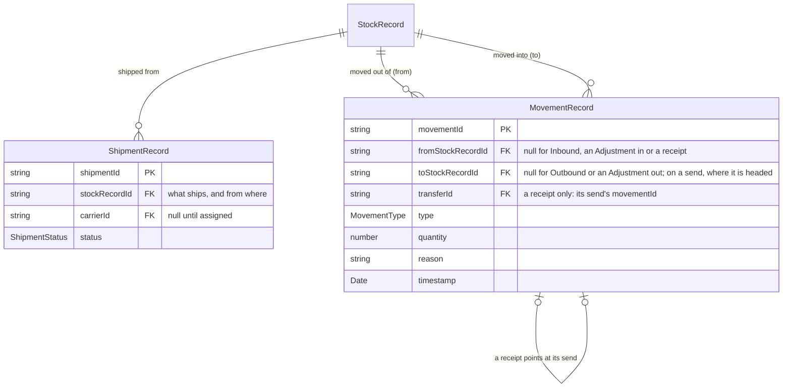
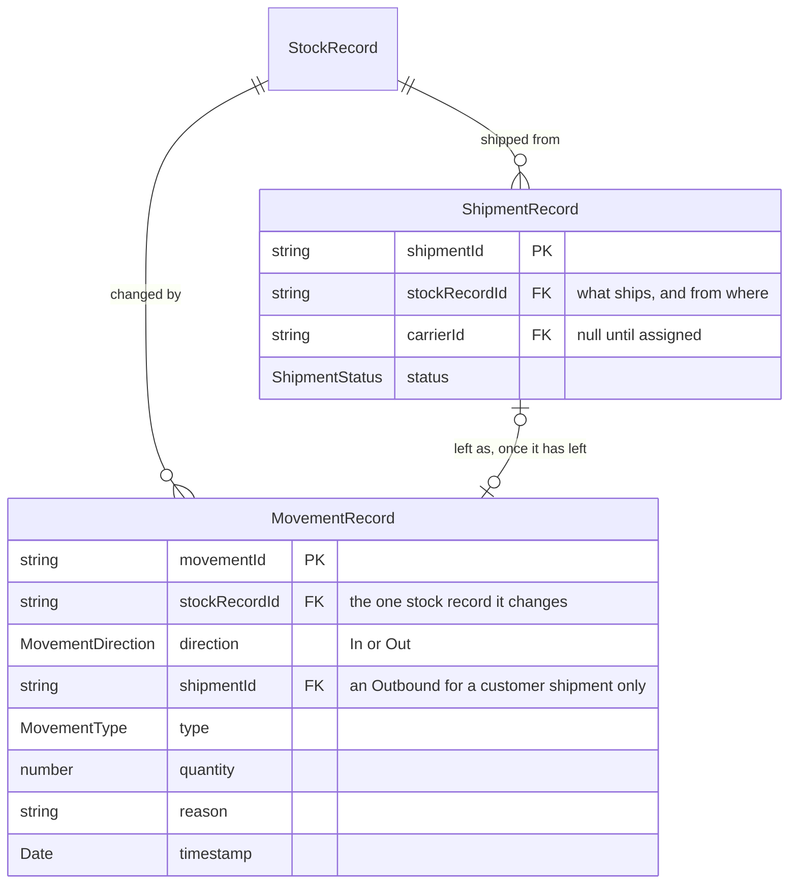

# Open questions

> **Date created**: 2026-11-17
> **Purpose**: questions for mae that a brief leaves open, one per heading, so each can be discussed and answered on its own. A choice waiting on mae that lives in another file, such as a plan's proposed extras, gets a one-line pointer under "Waiting elsewhere", so every open item can be found here (mae, 2026-11-18).
> **Rule**: each question says what the brief says, the options and a recommendation. When mae answers, the answer goes in `docs/decisions.md` (or the plan, for a small one), and the question leaves this file. Code built before an answer follows the recommendation, and its tests name the question, so a different answer later is a visible change.

Entry format:

```
### Q<N>. The question
- **Where it comes from**: the brief file and the part of it
- **What the brief says**: quoted or summarised
- **Options**: (a) ..., (b) ...
- **Recommendation**: one option, and why
- **Asked**: YYYY-MM-DD
```

---

## Milestone 2

Q1 to Q18 and Q20 to Q24 were answered by mae on 2026-11-17 and 2026-11-18 (`docs/decisions.md`, "Milestone 2's open questions answered", "Milestone 2 stores single-id records, with the brief's interfaces as views", "A transfer shows as a send and a receipt" and "Milestone 2's review questions answered"). Q19 is open, and WP1 waits on it. The next new question is Q25.

### Q19. How is a movement stored?
- **Where it comes from**: a review asked what the receipt's link to its send, `transferId`, should be called (2026-11-18). mae answered by rethinking `MovementRecord`, first around shipments and then, the same day, by going back to the briefing's own shape. This entry holds that second proposal and the version of it a review supports.
- **What the brief says**: `InventoryMovement` "tracks inventory changes (inbound or outbound)". It has one `warehouse`, a `type` (`"Inbound"`, `"Outbound"`, `"Transfer"`, `"Adjustment"`), a `quantity`, a `reason` and a `timestamp`. Nothing ties it to a `Shipment`, which is "a delivery order that needs to be shipped to a customer", and no required function works on movements.
- **Today** (`packages/warehouse-logic/docs/erd.md`, agreed 2026-11-18): a movement points at the stock it left (`fromStockRecordId`) and the stock it joined (`toStockRecordId`). A transfer is two movements, and the receipt points at its send through `transferId`.
- **mae's proposal** (2026-11-18): shipments stay deliveries to customers, and transfers stay inside the organization and are not shipments. A movement is one warehouse's own record of a change to its own stock: whether units came in or went out, how many, and why. It does not say where the units came from or where they are headed. Each warehouse writes its own. Every shipment has a matching Outbound movement, and a movement can exist with no shipment, as a transfer or an adjustment does. A movement's warehouse is always the warehouse that wrote it.
- **Review**: the proposal is consistent, and it is the brief's own reading of a movement. It is also the simplest of the models discussed. Three points need to be exact for it to hold:
  1. The marker of in or out is a field, `direction` (`"In"` or `"Out"`), stored on every movement. An Inbound is always In and an Outbound always Out; a Transfer and an Adjustment can be either.
  2. "Every shipment has a matching Outbound" is true once the shipment has left. A shipment that is Pending or Assigned has none yet. For the match to be checkable, not only assumed, the Outbound carries an optional `shipmentId`. It says which order the units left for, not where they went; the shipment knows that.
  3. A transfer's two movements, out of one warehouse and into the other, are not linked. That gives up the check mae wanted in Q14 and Q15, that every send has a receipt, and the count of units in transit. Q14's answer itself still holds: a transfer shows as a send at one warehouse and a receipt at the other.
- **Options**:
  - (a) **The proposal with points 1 and 2.** `MovementRecord` is `movementId`, `stockRecordId` (the one stock record it changes), `direction`, an optional `shipmentId`, and the brief's `type`, `quantity`, `reason` and `timestamp`. They replace `fromStockRecordId`, `toStockRecordId` and `transferId`. `ShipmentRecord` and `StockRecord` do not change. Linking a transfer's two halves is parked in `docs/FUTURE_WORK.md`.
  - (b) **The same without `shipmentId`.** The movement stays purely about stock. A shipment's Outbound can then be matched only by SKU, warehouse, quantity and time, or by the free text in `reason`.
  - (c) **The same as (a), and a transfer's receipt may point at its send** (an optional `sendMovementId`). It keeps the send-and-receipt check, and it makes one movement care about another warehouse's record, which the proposal set out to avoid.
- **Recommendation**: (a). Every movement touches one stock record, so stock is what came in less what went out, and the view's `warehouse` is always that record's warehouse, which is mae's last rule held by the structure itself. No field means two things, and the self-link and `transferId` go away. The link to the shipment sits on the movement because the movement is written once, when the units leave, and points at a record that already exists; a link on the shipment would need a second write that can be forgotten.
- **Until answered**: `erd.md` stays as agreed, and WP1 does not build `MovementRecord`, `toInventoryMovement` or the mock movements.
- **Asked**: 2026-11-18

Today:



Option (a):



Both diagrams leave out the fields that stay the same. The movements under option (a), each written by the warehouse whose stock changed:

| What happened at the warehouse | `type` | `direction` | `shipmentId` |
|---|---|---|---|
| Stock arrives from outside the organization | Inbound | In | none |
| A customer shipment leaves | Outbound | Out | that shipment |
| Stock is sent to the other warehouse | Transfer | Out | none |
| Stock arrives from the other warehouse | Transfer | In | none |
| A count is corrected upward | Adjustment | In | none |
| A count is corrected downward | Adjustment | Out | none |

## Waiting elsewhere

None right now. mae picked all of Milestone 2's extras, X1 to X5, on 2026-11-18 (`docs/milestones/milestone-2/plan.md`, "Proposed extras").
