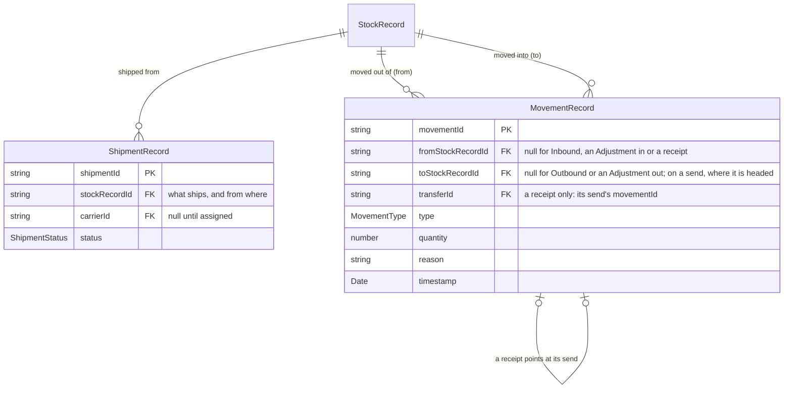
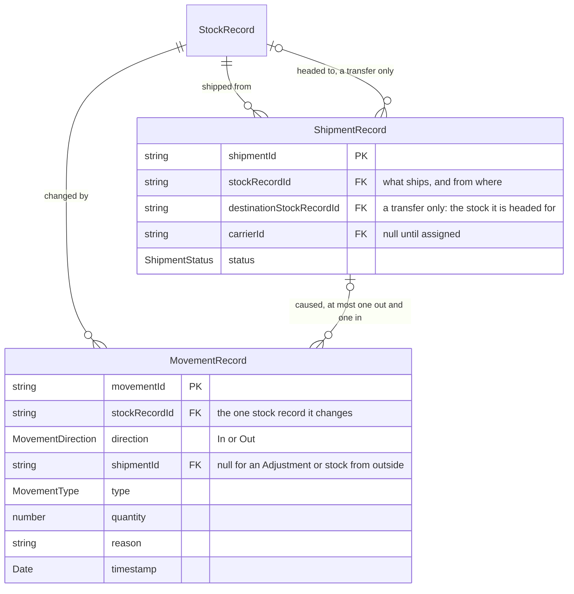

# Open questions

> **Date created**: 2026-11-17
> **Purpose**: questions for mae that a brief leaves open, one per heading, so each can be discussed and answered on its own. A choice waiting on mae that lives in another file, such as a plan's proposed extras, gets a one-line pointer under "Waiting elsewhere", so every open item can be found here (mae, 2026-11-18).
> **Rule**: each question says what the brief says, the options and a recommendation. When mae answers, the answer goes in `docs/decisions.md` (or the plan, for a small one), and the question leaves this file. Code built before an answer follows the recommendation, and its tests name the question, so a different answer later is a visible change.

Entry format:

```
### Q<N>. The question
- **Where it comes from**: the brief file and the part of it
- **What the brief says**: quoted or summarised
- **Options**: (a) ..., (b) ...
- **Recommendation**: one option, and why
- **Asked**: YYYY-MM-DD
```

---

## Milestone 2

Q1 to Q18 and Q20 to Q24 were answered by mae on 2026-11-17 and 2026-11-18 (`docs/decisions.md`, "Milestone 2's open questions answered", "Milestone 2 stores single-id records, with the brief's interfaces as views", "A transfer shows as a send and a receipt" and "Milestone 2's review questions answered"). Q19 is open, and WP1 waits on it. The next new question is Q25.

### Q19. How is a movement stored, and is it tied to a shipment?
- **Where it comes from**: a review asked what the receipt's link to its send, `transferId`, should be called (2026-11-18). mae answered with a wider idea: rethink `MovementRecord` so that a `ShipmentRecord` tracks a transfer's send and receipt, with stock coming into a warehouse from outside it and going out of it.
- **What the brief says**: `InventoryMovement` has one `warehouse`, a `type` (`"Inbound"`, `"Outbound"`, `"Transfer"`, `"Adjustment"`) and a `quantity`. Nothing ties it to a `Shipment`, and no required function works on movements. A `Shipment` is "a delivery order that needs to be shipped to a customer", and its `origin` must be one of the two warehouses.
- **Today** (`packages/warehouse-logic/docs/erd.md`, agreed 2026-11-18): a movement points at the stock it left (`fromStockRecordId`) and the stock it joined (`toStockRecordId`), and no shipment. A transfer is two movements. The send holds both, its `to` meaning "headed for"; the receipt holds a `to` and `transferId`, which is its send's `movementId`.
- **Options**:
  - (a) **Tied to a shipment, one stock record per movement.** A movement changes exactly one stock record: `stockRecordId` and a `direction` (`"In"` or `"Out"`) replace `fromStockRecordId`, `toStockRecordId` and `transferId`. It gains an optional `shipmentId`, and `ShipmentRecord` gains an optional `destinationStockRecordId`, set only for a transfer between warehouses. A customer delivery then has at most one movement, the Outbound when it leaves. A transfer is a shipment between two stock records with up to two movements, out of the sender and into the receiver, each with its own quantity and time, so mae's answers to Q14 and Q15 hold. Stock arriving from outside and an Adjustment have no shipment.
  - (b) **One movement per shipment, and every movement has a shipment**, as mae first put it. The shipment's status says whether a transfer has arrived. To keep Q14's receipt, `ShipmentRecord` needs a received quantity and a received time, which the brief's `Shipment` does not have. A delivery from a supplier and an Adjustment would need shipments too, and neither can be shown as the brief's `Shipment`: a supplier's `origin` is not one of the two warehouses, and an Adjustment is not a delivery.
  - (c) **Keep the agreed model** and only rename `transferId` to `sendMovementId`, the review's first recommendation.
- **Recommendation**: (a). It keeps what mae's idea is after: a shipment carries a transfer, with its status, carrier and date, and every dispatched customer shipment can be checked against the movement that took its stock. It also makes the model simpler than today's. Every movement touches one stock record, so stock is what came in less what went out, the view's `warehouse` is always that record's warehouse, no field means two things, and the self-link and `transferId` go away. Two things in (b) can't hold as stated: an Adjustment and a supplier's delivery have no shipment the brief can show, and one movement can't record a different received quantity.
- **What (a) changes elsewhere**: `StockRecord` keeps its fields. `stockQuantity` stays stored, because the briefing gives stock figures with no movements behind them; checking stock against movements is parked in `docs/FUTURE_WORK.md`. A transfer becomes a `ShipmentRecord`, and the brief's reports are about customer deliveries, so the builder of many shipments would leave transfers out. That rule is confirmed with mae if (a) is picked.
- **Until answered**: `erd.md` stays as agreed, and WP1 does not build `MovementRecord`, `toInventoryMovement` or the mock movements.
- **Asked**: 2026-11-18

Today:



Option (a):



Both diagrams leave out the fields that stay the same. The movements under option (a):

| What happened | `type` | `direction` | `shipmentId` |
|---|---|---|---|
| Stock arrives from outside | Inbound | In | none |
| A customer shipment leaves | Outbound | Out | the customer shipment |
| A transfer leaves the sending warehouse | Transfer | Out | the transfer's shipment |
| A transfer arrives at the receiving warehouse | Transfer | In | the same shipment |
| A count is corrected upward | Adjustment | In | none |
| A count is corrected downward | Adjustment | Out | none |

## Waiting elsewhere

None right now. mae picked all of Milestone 2's extras, X1 to X5, on 2026-11-18 (`docs/milestones/milestone-2/plan.md`, "Proposed extras").
