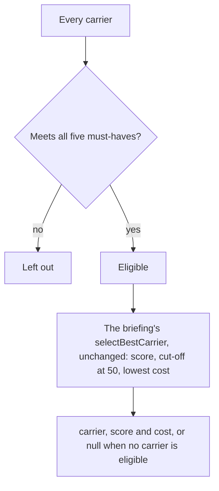
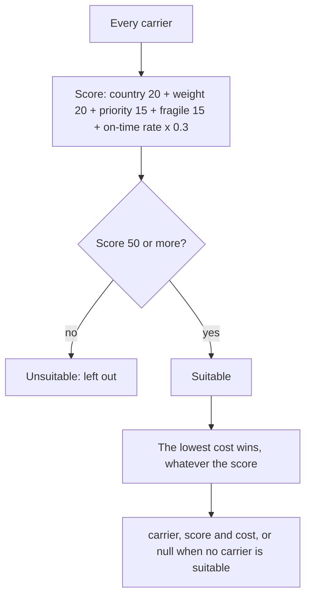
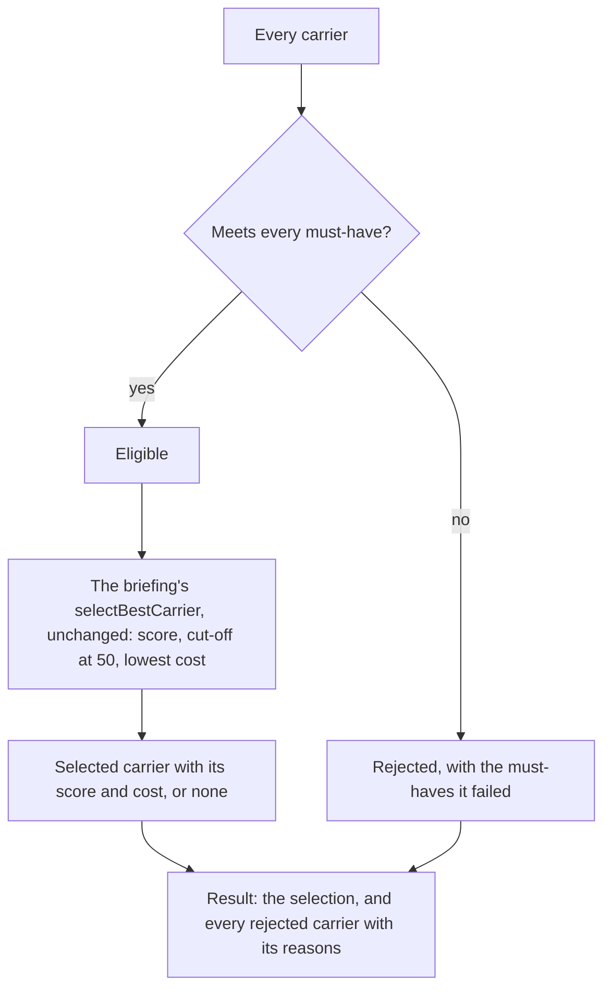

# Carrier selection review

How the briefing's `selectBestCarrier` picks a carrier, the ways it picks a wrong one, and the fix mae decided on (plan WP7, D4). This is the analysis only: it holds no code, and the briefing's functions stay exactly as they are.

> **Status**: decided by mae on 2026-11-19. The answers to the five choices are under "What mae decided" and in `docs/decisions.md`, "Carrier selection departure: five must-haves in front of the briefing's selection". The code is not built yet.

## Summary

- **The briefing's rules are followed exactly, and the result is still wrong.** The sample shipment to Madrid goes to UPS, which operates only in the United States. Every rule is applied as written and pinned by tests.
- **The cause is one design choice.** The briefing turns four yes-or-no facts (does the carrier serve the country, can it carry the weight, does it accept the priority, can it handle fragile goods) into points, adds them to a reliability score, and accepts any carrier with 50 points or more. A carrier can fail one or two of those facts, sometimes three, and still pass. The cheapest carrier that passes then wins, whatever its score.
- **With the briefing's three sample carriers it is not an edge case.** UPS has the lowest rates, so it wins every shipment there is, to either country, at any weight and any priority, with one exception: a Same-day shipment to Spain over 30 kg, which goes to SEUR, which cannot carry it either. DHL Express is never picked for anything.
- **This review finds ten failure cases**, F1 to F10. Five are a carrier winning a job it cannot do. Four are things the rules never look at. One is an answer that says too little.
- **Recommendation.** Put a must-have check in front of the briefing's function: a carrier that fails a must-have is not eligible, and the briefing's score, cut-off and lowest-cost rule then run unchanged on the eligible carriers. Make all four yes-or-no rules must-haves, not only country and weight, and return the reasons each rejected carrier was left out.

| Choice | Question | Recommended |
|---|---|---|
| CS1 | Which rules become must-haves? | All four: country, weight, priority and fragile |
| CS2 | Which country must the carrier operate in? | The origin warehouse's and the destination's |
| CS3 | Which weight is held against the carrier's limit? | The whole shipment's, as the briefing's rule says |
| CS4 | What does the new function return? | The selected carrier, plus every rejected carrier with the must-haves it failed |
| CS5 | What decides among eligible carriers? | The lowest cost, as the briefing says |

## What mae decided

mae answered all five choices on 2026-11-19. Four follow the recommendation. On CS4 mae chose the simpler answer.

| Choice | mae's answer |
|---|---|
| CS1 | (b) All four yes-or-no rules are must-haves: country, weight, priority and fragile |
| CS2 | (b) The carrier must operate in the origin warehouse's country and in the destination's |
| CS3 | (a) The whole shipment's weight is held against the carrier's limit |
| CS4 | (a) The briefing's shape, `{ carrier, score, cost } \| null`: "for now, just name the winner. if we need readouts later as to why things failed, we can expand then." |
| CS5 | (a) The lowest cost decides among eligible carriers |

So the new function has five must-haves: the destination's country, the origin's country, the weight, the priority and fragile handling. It takes the carriers, the shipment, the product and the warehouses, leaves out every carrier that fails a must-have, and returns what the briefing's `selectBestCarrier` returns for the carriers that remain. It names the winner and does not say why the others were left out.

Parked in `docs/FUTURE_WORK.md`: a result that says why each carrier was left out (CS4, F9, F10), splitting a large order into packages (CS3, F7), and letting reliability and speed count (CS5, F8).

## How the briefing selects a carrier

`scoreCarrierForShipment` adds five rules (briefing, "Carrier Scoring and Cost Calculation"):

| Rule | Points |
|---|---|
| Operates in the destination country | 20 or 0 |
| Can handle the weight (`product.weightKg * shipment.quantity <= carrier.maxWeightKg`) | 20 or 0 |
| Supports the priority | 15 or 0 |
| Handles fragile (or the product is not fragile) | 15 or 0 |
| Reliability | `onTimeRate * 0.3`, so 0 to 30 |

`selectBestCarrier` then scores every carrier, leaves out those under 50, and returns the cheapest of the rest.

The code follows this to the letter. `src/utils/transformations.ts` has one check per rule, and `tests/transformations.test.ts` and `tests/transformations.independent.test.ts` pin each rule on both sides, the cut-off at exactly 50, the ties and the sample figures worked by hand (`docs/transformations.md`). mae's answers Q4 to Q6, Q30 and Q33 settle what the briefing leaves open (`docs/decisions.md`).

## Why it goes wrong

The four yes-or-no rules are worth 70 points and the cut-off is 50, so a carrier does not need all four. The table lists every combination of rules a carrier can miss, and the on-time rate it needs to reach 50 anyway.

| Rules missed | Points left from the four rules | On-time rate needed to reach 50 |
|---|---|---|
| None | 70 | Any, even 0% |
| Country | 50 | Any, even 0% |
| Weight | 50 | Any, even 0% |
| Priority | 55 | Any, even 0% |
| Fragile | 55 | Any, even 0% |
| Priority and fragile | 40 | 34% |
| Country and priority | 35 | 50% |
| Country and fragile | 35 | 50% |
| Weight and priority | 35 | 50% |
| Weight and fragile | 35 | 50% |
| Country and weight | 30 | 67% |
| Country, priority and fragile | 20 | 100% |
| Weight, priority and fragile | 20 | 100% |
| Country, weight and priority | 15 | Never |
| Country, weight and fragile | 15 | Never |
| All four | 0 | Never |

Thirteen of the sixteen combinations can pass. Missing any single rule never rules a carrier out, at any on-time rate. The sample carriers are on time 88%, 92% and 95% of the time, so each of them passes with any two rules missed.

Two more facts follow from the rules:

- **The cut-off can never leave out a carrier that can do the job.** A carrier that passes all four rules has at least 70 points. The briefing's cut-off only ever lets carriers in.
- **Above the cut-off the score stops counting.** The cheapest suitable carrier wins, so a score of 50 beats a score of 98.5 by one cent.

### What that does to the sample carriers

UPS has the lowest base rate, rate per kg and rate per km of the three (5.00, 1.20 and 0.05, against SEUR's 6.50, 1.50 and 0.08 and DHL Express's 12.00, 2.00 and 0.10). The priority surcharge multiplies every carrier's cost by the same factor. So for any shipment UPS costs least, SEUR next and DHL Express most, and the winner is the first of those three that scores 50.

- UPS handles fragile goods, so it can miss at most country, weight and priority. It drops under 50 only when it misses all three (15 + 26.4 = 41.4).
- SEUR accepts every priority and handles fragile goods, so it can miss at most country and weight, which leaves 30 + 27.6 = 57.6. SEUR is always suitable.
- DHL Express is therefore never the cheapest suitable carrier.

The table shows who is picked for each kind of domestic shipment. It was checked by running the three versions on 28,800 mock shipments built from the briefing's three products (1 to 400 units, each priority, each country, four distances): every shipment in a cell gave the cell's answer. Option (a) and option (b) are CS1's, below.

| Destination | Priority | Shipment weight | The briefing | Option (a): country and weight | Option (b): all four |
|---|---|---|---|---|---|
| United States | Standard | up to 30 kg | UPS | UPS | UPS |
| United States | Standard | over 30, up to 50 kg | UPS ✗ | DHL Express ✗ | none |
| United States | Express | up to 30 kg | UPS | UPS | UPS |
| United States | Express | over 30, up to 50 kg | UPS ✗ | DHL Express | DHL Express |
| United States | Same-day | up to 30 kg | UPS ✗ | UPS ✗ | DHL Express |
| United States | Same-day | over 30, up to 50 kg | UPS ✗ | DHL Express | DHL Express |
| Spain | Standard | up to 25 kg | UPS ✗ | SEUR | SEUR |
| Spain | Standard | over 25, up to 50 kg | UPS ✗ | DHL Express ✗ | none |
| Spain | Express | up to 25 kg | UPS ✗ | SEUR | SEUR |
| Spain | Express | over 25, up to 50 kg | UPS ✗ | DHL Express | DHL Express |
| Spain | Same-day | up to 25 kg | UPS ✗ | SEUR | SEUR |
| Spain | Same-day | over 25, up to 30 kg | UPS ✗ | DHL Express | DHL Express |
| Spain | Same-day | over 30, up to 50 kg | SEUR ✗ | DHL Express | DHL Express |
| Any | Any | over 50 kg | UPS ✗ (SEUR ✗ for Same-day to Spain) | none | none |

✗ marks a carrier that fails at least one of the four rules for that shipment. The briefing's pick is right in two rows of fourteen. "none" means no sample carrier can do the job: over 50 kg none can carry it, and for a Standard shipment over the UPS or SEUR limit the only carrier left is DHL Express, which the briefing's data says accepts Express and Same-day only.

## Failure cases

Every figure here was worked by hand from the briefing's formulas and then confirmed by running the package's own functions. Products and carriers are the briefing's samples unless a line says mock. The briefing has one sample shipment, so the other shipments are mock: they go to "Mock City", and their quantities and distances are invented for the example.

### A carrier wins a job it cannot do

**F1. It does not operate in the destination country (plan D4).** The briefing's sample shipment: one Dell laptop (2.3 kg, fragile), Express, Zaragoza to Madrid, 320 km.

| Carrier | Country | Weight | Priority | Fragile | Reliability | Score | Cost |
|---|---|---|---|---|---|---|---|
| UPS | 0 | 20 | 15 | 15 | 26.4 | 76.4 | $30.89 |
| SEUR | 20 | 20 | 15 | 15 | 27.6 | 97.6 | $46.22 |
| DHL Express | 20 | 20 | 15 | 15 | 28.5 | 98.5 | $63.18 |

The briefing picks UPS, which serves only the United States. The right answer is SEUR.

**F2. It cannot carry the weight.** Mock shipment: 40 pairs of the sample shoes (0.8 × 40 = 32 kg), Express, Los Angeles to a United States address 100 km away.

| Carrier | Country | Weight | Priority | Fragile | Reliability | Score | Cost |
|---|---|---|---|---|---|---|---|
| UPS (limit 30 kg) | 20 | 0 | 15 | 15 | 26.4 | 76.4 | (5 + 38.40 + 5) × 1.3 = $62.92 |
| SEUR (limit 25 kg) | 0 | 0 | 15 | 15 | 27.6 | 57.6 | (6.50 + 48 + 8) × 1.3 = $81.25 |
| DHL Express (limit 50 kg) | 20 | 20 | 15 | 15 | 28.5 | 98.5 | (12 + 64 + 10) × 1.3 = $111.80 |

The briefing picks UPS, 2 kg over its limit. The right answer is DHL Express.

**F3. It does not accept the priority.** Mock shipment: one pair of the sample shoes, Same-day, Los Angeles to a United States address 20 km away.

| Carrier | Country | Weight | Priority | Fragile | Reliability | Score | Cost |
|---|---|---|---|---|---|---|---|
| UPS (Standard, Express) | 20 | 20 | 0 | 15 | 26.4 | 81.4 | (5 + 0.96 + 1) × 1.6 = $11.14 |
| SEUR | 0 | 20 | 15 | 15 | 27.6 | 77.6 | (6.50 + 1.20 + 1.60) × 1.6 = $14.88 |
| DHL Express | 20 | 20 | 15 | 15 | 28.5 | 98.5 | (12 + 1.60 + 2) × 1.6 = $24.96 |

The briefing picks UPS, which does not offer Same-day. The customer was promised today. The right answer is DHL Express. Making only country and weight must-haves does not fix this one: UPS serves the country and can carry the weight, so it is still picked.

**F4. It cannot handle fragile goods.** All three sample carriers handle fragile goods, so this case needs a mock carrier: Spain only, does not handle fragile, 90% on time, rates 3.00, 1.00 per kg and 0.04 per km, Standard and Express. The shipment is the briefing's sample (a fragile laptop).

| Carrier | Country | Weight | Priority | Fragile | Reliability | Score | Cost |
|---|---|---|---|---|---|---|---|
| Mock carrier | 20 | 20 | 15 | 0 | 27 | 82 | (3 + 2.30 + 12.80) × 1.3 = $23.53 |
| UPS | 0 | 20 | 15 | 15 | 26.4 | 76.4 | $30.89 |
| SEUR | 20 | 20 | 15 | 15 | 27.6 | 97.6 | $46.22 |
| DHL Express | 20 | 20 | 15 | 15 | 28.5 | 98.5 | $63.18 |

The briefing picks the mock carrier for a fragile laptop. Country and weight as the only must-haves do not fix this one either.

**F5. It fails two rules, or three, and still wins.** Mock shipment: 20 of the sample laptops (2.3 × 20 = 46 kg), Zaragoza to Madrid, 320 km.

| Priority | UPS (United States only, limit 30 kg) | SEUR (limit 25 kg) | DHL Express | The briefing picks |
|---|---|---|---|---|
| Express | 0 + 0 + 15 + 15 + 26.4 = 56.4, $99.06 | 77.6, $131.43 | 98.5, $176.80 | UPS: wrong country and 16 kg over its limit |
| Same-day | 0 + 0 + 0 + 15 + 26.4 = 41.4, out | 20 + 0 + 15 + 15 + 27.6 = 77.6, $161.76 | 98.5, $217.60 | SEUR: 21 kg over its limit |

DHL Express is the only carrier that can take either shipment, and it is picked for neither. Three misses can pass too: a mock carrier that is on time 100% of the time, serves only the United States, takes only Standard and does not handle fragile goods scores 0 + 20 + 0 + 0 + 30 = 50 for the sample laptop sent Same-day to Madrid. That is exactly the cut-off, so it is suitable, and at a low enough price it wins.

### Things the rules never look at

**F6. The origin's country.** The country rule reads `shipment.destination.country` only. A carrier collects the parcel at the origin warehouse, so it has to operate there too. For a shipment inside one country the two checks are the same. They differ when origin and destination are in different countries. Mock shipment: one pair of the sample shoes, Express, Los Angeles to Spain, at a mock distance of 9,000 km.

| Carrier | Operates in | Score | Cost |
|---|---|---|---|
| UPS | United States | 76.4 | $592.75 |
| SEUR | Spain | 97.6 | $946.01 |
| DHL Express | United States, Spain | 98.5 | $1,187.68 |

The briefing picks UPS. A must-have on the destination country alone picks SEUR, which has nobody in Los Angeles to collect the parcel. Only DHL Express operates at both ends. Neither the briefing nor `CONTEXT.md` says whether TrackFlow ships between its two countries, so this is CS2.

**F7. The limit is per package, the weight is the whole order.** The briefing's `maxWeightKg` is the "maximum package weight they accept", and its weight rule compares that with `product.weightKg * shipment.quantity`, the whole shipment. Mock shipment: 100 pairs of the sample shoes (80 kg), Standard, Los Angeles to a United States address 100 km away. Each pair weighs 0.8 kg and would travel as several boxes, yet 80 kg is over every sample carrier's limit (30, 25 and 50 kg).

Under the briefing this costs each carrier 20 points and changes nothing: UPS still wins (76.4, $106.00). As a must-have it becomes decisive: no carrier is eligible, and the shipment has no answer. So making weight a must-have fixes F2 and, on the briefing's reading of weight, makes large orders of small items impossible to assign. That is CS3.

**F8. Reliability and speed.** The briefing's task list says "Score carriers based on cost, speed, and reliability". Reliability is 30 of the 100 points, but the score only decides who passes the cut-off, and a carrier that passes all four rules passes at any on-time rate (70 + 0 = 70). After that only cost counts. Mock example: the sample laptop sent Standard to Madrid, with SEUR (92% on time, $35.55) and a mock carrier with SEUR's figures except a base rate one cent lower and 40% on time ($35.54). The briefing picks the mock carrier, score 82 against 97.6, for one cent. Speed is not in the rules at all: `avgDeliveryDays` is never read. Must-haves do not change either point. That is CS5.

**F9. Whether the product is the one being shipped.** `selectBestCarrier(carriers, shipment, product)` takes any product. Given the sample shipment, which carries a laptop, and the sample shoes, it answers without complaint (UPS, $28.55), with the weight and the fragile rule read from the wrong product. Nothing checks that `product.sku` is `shipment.sku` or that the product is stocked at `shipment.origin`.

### An answer that says too little

**F10. `null` does not say why.** The briefing's function returns `null` for an empty carrier list, for carriers that all score under 50 and for costs that cannot be compared, and the caller cannot tell which. Today `null` is rare, because nearly every carrier passes. Once must-haves leave carriers out, "no carrier" becomes a normal answer (the "none" cells above), and a coordinator needs to know what to change: split the order, change the priority, or call a carrier that is not on the list.

**Data that breaks a validation rule** (an on-time rate of 150, a negative rate, an unknown priority) is Q32, not this review: the briefing's functions calculate with what they are given, and a checked version with warnings is being built beside them (`docs/open-questions.md`). The functions proposed here would build on it.

## Research

**Requirements and preferences are different kinds of criteria.** Decision methods separate the two. Kepner and Tregoe's decision analysis sorts objectives into MUSTs and WANTs: a MUST is mandatory and measurable, an option that fails one is dropped before any scoring, and only the WANTs are weighted and scored. Their summary is that the musts decide who gets to play and the wants decide who wins. Decision research calls the briefing's kind of rule compensatory: in a weighted sum a strong attribute makes up for a weak one. A conjunctive rule is the non-compensatory kind: an option must clear a minimum on every attribute, and failing one removes it. The briefing uses a compensatory rule for facts that cannot be compensated. An excellent on-time record does not move a parcel through a country the carrier does not serve.

**Shipping software filters first, then compares prices.** Descriptions of multi-carrier rate shopping (EasyPost, ShipStation, Shippo, Calcurates) give the same order: narrow the carriers and services to those eligible for the shipment, by destination, by weight, size and value limits, and by the delivery time promised, then pick the cheapest of what is left. That is the briefing's "lowest cost" rule with the eligibility step it lacks.

**Carrier weight limits are per parcel.** UPS's own size and weight page gives a maximum weight "per parcel". That matches the briefing's wording for `maxWeightKg` and is what F7 turns on.

**The company's own words.** `CONTEXT.md` (Last Mile and Carrier Management) asks for "a carrier selection engine that recommends the optimal carrier given destination, weight, and urgency". Those three are the country, weight and priority rules, named as what the choice is made from. It also lists "intelligent carrier selection with explainable recommendations" among TrackFlow's challenges, and says there is today "no historical performance data: no on-time delivery rate". The first supports priority as a must-have (CS1), the second an answer that explains itself (CS4), and the third keeping reliability out of the must-haves for now (CS5).

Sources are listed at the end, with what could and could not be opened from this session.

## The proposed departure

This section is the proposal as mae read it. Where the answer differs from it, which is CS4 only, "What mae decided" above is what gets built.

One step goes in front of the briefing's function. Nothing in the briefing's function changes, and it is called as it is on the carriers that pass.

- **Beside, not in place.** `calculateShippingCost`, `scoreCarrierForShipment` and `selectBestCarrier` keep their names, signatures, behaviour and tests. The known failure stays visible under its own name. The new functions are new exports of `src/utils/transformations.ts`, with a new test file that shows the briefing's result and the improved one side by side for each case above (plan, Phase 4).
- **One source of truth.** The must-haves reuse the rule checks that already exist (`carrierOperatesInCountry`, `carrierCanCarryWeight`, `carrierAcceptsPriority`, `carrierCanHandleFragility`), so a rule is written once and read by both the briefing's score and the new check.
- **Working names**, to be settled in the code's pull request: a list of the must-haves that a type is derived from, a function that returns the must-haves one carrier fails for a shipment, and a selection function that returns the result drawn above.

### Choices for mae

Each is a separate choice. The recommendation is first in each list of reasons.

#### CS1. Which rules become must-haves?

- **(a) Country and weight**, as agreed in D4 (2026-11-17). Fixes F1, F2 and F5 wherever country or weight is one of the misses. Leaves F3 and F4: a Same-day shipment still goes to a carrier with no Same-day service, and a fragile product to a carrier that does not handle fragile goods. Priority and fragile stay as points, where they can almost never rule a carrier out (missing both needs an on-time rate under 34%).
- **(b) All four: country, weight, priority and fragile.** Fixes F1 to F5. More shipments get "no carrier" as their answer, which is true of the data and is what CS4 explains.
- **(c) Country, weight and priority**, the three `CONTEXT.md` names. Fixes F1, F2, F3 and F5, leaves F4.

**Recommendation: (b).** All four are yes-or-no facts about whether the carrier can do this job, and a carrier that fails any of them cannot deliver what was promised. D4 named country and weight because the Madrid case showed those two; F3 and F4 are the same failure in the other two rules. With (b) the briefing's score and cut-off are still calculated and returned, but they no longer leave anyone out: an eligible carrier has at least 70 points.

**mae, 2026-11-19: (b).** Country, weight, priority and fragile are all must-haves.

#### CS2. Which country must the carrier operate in?

- **(a) The destination's**, as the briefing's rule reads. Leaves F6.
- **(b) The origin warehouse's and the destination's.** For a shipment inside one country this is the same check as (a). The function needs the origin's country, which the stored `Warehouse` record has, so it takes the warehouses as one more parameter.
- **(c) The destination's, and flag a shipment whose origin and destination countries differ** as a warning, without leaving any carrier out for it.

**Recommendation: (b).** It costs nothing for domestic shipments and is the only safe answer for the others. If TrackFlow never ships between its countries, (b) and (a) give the same results on real data.

**mae, 2026-11-19: (b).** The carrier must operate in the origin warehouse's country and in the destination's.

#### CS3. Which weight is held against the carrier's limit?

- **(a) The whole shipment's**, `product.weightKg * shipment.quantity`, as the briefing's rule says and as Q30 was answered. A large order of small items (F7) then has no eligible carrier, and the result says so with the weight and each carrier's limit.
- **(b) One unit's**, `product.weightKg`, on the reading that a shipment travels as several packages. Fixes F7. But the briefing's cost formula charges one base rate for the shipment, and no data says how many units go in a box, so the cost of a shipment split into packages would be a guess.

**Recommendation: (a).** It is the briefing's own formula, and "no carrier can take 80 kg in one shipment" is a true and useful answer. Splitting an order into packages is real work with its own data needs, and belongs in `docs/FUTURE_WORK.md`.

**mae, 2026-11-19: (a).** The whole shipment's weight is held against the carrier's limit.

#### CS4. What does the new function return?

- **(a) The briefing's shape**, `{ carrier, score, cost } | null`. A drop-in replacement, and F10 stays.
- **(b) An explained result**: the selected carrier with its score and cost, or none, and a list of every rejected carrier with the must-haves it failed. For the 32 kg Standard shipment of F2 under CS1 (b), it would say: no carrier selected; UPS cannot carry the weight (32 kg, limit 30 kg); SEUR does not operate in the United States and cannot carry the weight (limit 25 kg); DHL Express does not accept Standard.

**Recommendation: (b).** It is "grace, but flagged" (Q29) applied here, it matches `CONTEXT.md`'s "explainable recommendations", and the selected carrier inside it has the briefing's shape, so a caller who wants only that reads one field. F9 fits here too: a product whose SKU is not the shipment's can be returned as a warning beside the result.

**mae, 2026-11-19: (a).** "for now, just name the winner. if we need readouts later as to why things failed, we can expand then." The new function returns the briefing's shape, and the explained result is parked in `docs/FUTURE_WORK.md`.

#### CS5. What decides among eligible carriers?

- **(a) The lowest cost**, as the briefing says. F8 stays: reliability and speed do not affect the choice.
- **(b) A minimum on-time rate as a fifth must-have.** It needs a figure, and no source gives one. `CONTEXT.md` says TrackFlow has no on-time data yet, so the figure would be invented (Hard rule 2).
- **(c) The highest score, with cost as the tie-break.** This reverses the briefing's rule. With the sample carriers DHL Express, the most expensive, would win wherever it is eligible.

**Recommendation: (a).** It keeps the briefing's rule, and it is how rate shopping works once eligibility is settled. (b) is worth doing when TrackFlow has real carrier performance data and Carlos Vega's team can name a floor; until then it goes in `docs/FUTURE_WORK.md`, with speed against a promised delivery date, which needs a date the briefing's `Shipment` does not have.

**mae, 2026-11-19: (a).** The lowest cost decides among eligible carriers, as the briefing says.

### Before and after

The same cases under the briefing, under D4 as agreed (CS1 (a)), and under the recommendation (CS1 (b) with CS2 (b) and CS3 (a)).

| Case | Shipment | The briefing | Country and weight only | Recommended |
|---|---|---|---|---|
| F1 | Sample: 1 laptop, Express, Zaragoza to Madrid | UPS, $30.89 ✗ | SEUR, $46.22 | SEUR, $46.22 |
| F2 | 40 shoes (32 kg), Express, within the United States | UPS, $62.92 ✗ | DHL Express, $111.80 | DHL Express, $111.80 |
| F3 | 1 pair of shoes, Same-day, within the United States | UPS, $11.14 ✗ | UPS, $11.14 ✗ | DHL Express, $24.96 |
| F4 | Sample shipment, with the mock carrier that does not handle fragile | Mock carrier, $23.53 ✗ | Mock carrier, $23.53 ✗ | SEUR, $46.22 |
| F5 | 20 laptops (46 kg), Express, Zaragoza to Madrid | UPS, $99.06 ✗ | DHL Express, $176.80 | DHL Express, $176.80 |
| F5 | The same, Same-day | SEUR, $161.76 ✗ | DHL Express, $217.60 | DHL Express, $217.60 |
| F6 | 1 pair of shoes, Express, Los Angeles to Spain | UPS, $592.75 ✗ | SEUR, $946.01 ✗ (cannot collect in Los Angeles) | DHL Express, $1,187.68 |
| F7 | 100 shoes (80 kg), Standard, within the United States | UPS, $106.00 ✗ | none | none, with each carrier's reason |
| F2, Standard | 40 shoes (32 kg), Standard, within the United States | UPS, $48.40 ✗ | DHL Express, $86.00 ✗ (does not accept Standard) | none, with each carrier's reason |
| F8 | Sample laptop, Standard, SEUR against a 40% on-time mock carrier one cent cheaper | Mock carrier, $35.54 | Mock carrier, $35.54 | Mock carrier, $35.54 (CS5) |

✗ marks a pick that fails one of the four rules, or the origin's country. The recommended column costs more in every row where it names a different carrier. That is the price of a carrier that can do the job, and the briefing's lower figures were never available: the cheaper carrier could not have made the delivery.

The last three rows are the honest limits of the recommendation. Two of them answer "none" where the briefing names a carrier, and one keeps a pick mae may not like. Each is a true statement about the data: the three sample carriers cannot move 80 kg as one shipment, or 32 kg at Standard priority, and the rules as recommended still let price beat reliability.

As decided, the "Recommended" column is what the new function returns, without the reasons: where the column says "none", it returns `null`.

## When the code is built

mae agreed to this review on 2026-11-19. The code now waits for two merges that also change `src/utils/transformations.ts`: WP6 (the demo, the test page and the README, which the new exports are then added to) and the checked cost and scoring functions (Q32).

- Medium risk tier, as for WP4 (plan D9): tests written from this document before the code, a second set written from it in a separate context, and a fresh-context review.
- A new test file, so the briefing's tests are untouched. For each case above it asserts the briefing's result and the new result side by side, with the expected values worked by hand here.
- The departure is logged in `docs/decisions.md` with mae's answers to CS1 to CS5, and what is not built is parked in `docs/FUTURE_WORK.md`.

## How this was checked

- Each worked figure was calculated by hand from the briefing's formulas and then compared with the output of the package's own `evaluateCarriersForShipment` and `selectBestCarrier` on the same inputs. All agree.
- The "Option" and "Recommended" columns come from a throwaway script that filtered the carriers with the existing rule checks and then called the briefing's `selectBestCarrier`, which is the design proposed above. The script is not in the repository, and nothing in `src/` or `tests/` changed.
- The table of sixteen combinations was calculated by hand and confirmed by a loop over whole on-time percentages, using the rounded score (Q33).
- The table of sample carriers was reasoned from the rates and limits, then confirmed on 28,800 mock shipments. The mock shipments test the rule; they say nothing about what TrackFlow actually ships.
- Not done: no test was added, because no code was. The must-have functions do not exist yet.

## Sources

- `docs/milestones/milestone-2/trackflow-BRIEFING.en.md`, "Carrier Scoring and Cost Calculation" and "Sample Data".
- `CONTEXT.md`, "Last Mile and Carrier Management" and the closing paragraph on TrackFlow's AI challenges.
- Charles H. Kepner and Benjamin B. Tregoe, *The New Rational Manager* (Princeton Research Press, 1981), the chapter on decision analysis, for MUST and WANT objectives.
- John R. Hauser, Min Ding and Steven P. Gaskin, "Non-Compensatory (and Compensatory) Models of Consideration-Set Decisions" (Sawtooth Software Conference Proceedings, 2009), for compensatory and conjunctive rules.
- EasyPost, "Unlock the Power of Rate Shopping for Enterprise Businesses" (2025); Calcurates, "How Rate Shopping feature works"; ShipStation's and Shippo's rate comparison pages, for filtering by eligibility before comparing prices.
- UPS, "Parcel Dimensions, Size Limits and Weight Guide" (ups.com, United Kingdom), for limits stated per parcel.

The external sources were found by web search on 2026-11-19. The session's network proxy blocked the pages themselves (kepner-tregoe.com, stuff.mit.edu, help.calcurates.com and ups.com), so what this review says about them is what the search results reported, not text read from the page. ❓ Opening each page from a browser would confirm it. No figure from an external source is used in the review's own calculations.
