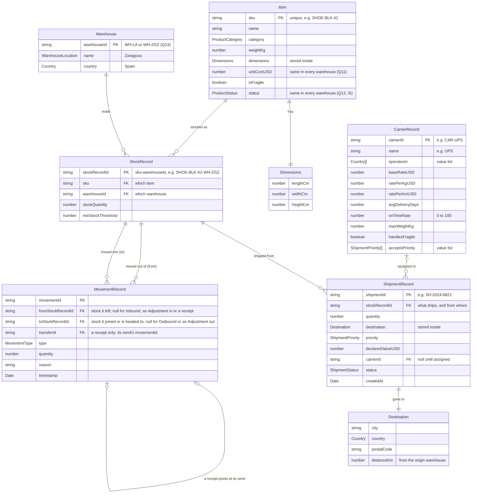

# Warehouse logic: entity relationship diagram

> **Status**: Agreed by mae (2026-11-18). It is the stored structure, with the brief's interfaces as views, a departure from the brief logged in `docs/decisions.md` ("Milestone 2 stores single-id records, with the brief's interfaces as views"). A review the same day named the stored carrier `CarrierRecord` and set the movement shapes out as a table; the model itself is unchanged.
> **Source**: `docs/milestones/milestone-2/trackflow-BRIEFING.en.md`, "Business Entities", and mae's design (2026-11-17 and 2026-11-18). Every business field and value comes from the briefing, and the new records (`Item`, `Warehouse`, `StockRecord`) regroup them. What the model adds is its own keys and links: the warehouse id, in mae's format (Q13), and `stockRecordId`, `fromStockRecordId`, `toStockRecordId` and `transferId`. `Warehouse.country` is the briefing's "United States (Los Angeles) and Spain (Zaragoza)".

## The diagram

How the data is stored. Every record has one id, and every link is one id pointing at one id.

How to read it: `PK` (primary key) marks the field that identifies a record, so no two records share it. Each is named for what it identifies (`warehouseId`, `shipmentId`), and the SKU is the item's. `FK` (foreign key) marks a field that holds another record's key, and has that key's name, with `from` or `to` in front where a record points at two. The ends of each line read `||` exactly one, `|o` zero or one, and `o{` zero or more. `Dimensions` and `Destination` are not separate records: they are objects stored inside an item or a shipment, drawn as boxes only so their fields can be seen.

## The records

- **`Item`**: one per SKU, so the SKU is unique and is the item's key (`sku`). It holds everything that is the same in every warehouse. By mae's answers that includes `unitCostUSD` (Q11) and `status` (Q12). A status per warehouse is improvement I5.
- **`Warehouse`**: one per warehouse, with a `warehouseId` in the carriers' style (`WH-LA`, `WH-ZGZ`), its `name` (the briefing's `WarehouseLocation`) and its `country`.
- **`StockRecord`**: one per item per warehouse. It holds the stock (`stockQuantity`, `minStockThreshold`). Its `stockRecordId` is the SKU, a hyphen, then the `warehouseId` (Q13), so the same item can never have two records in one warehouse. SKUs contain hyphens too, so an id is split by matching the known warehouse id at its end. This is the ProductId mae described.
- **`ShipmentRecord`**: a shipment (`shipmentId`), pointing at the stock it ships from (`stockRecordId`) and at its carrier by id (`carrierId`), so renaming a carrier changes nothing (improvement I1, now part of the design).
- **`MovementRecord`**: an inventory movement (`movementId`), pointing at the stock it left (`fromStockRecordId`) and the stock it joined (`toStockRecordId`). An Inbound movement has only a `to`, an Outbound only a `from`, and an Adjustment one of them. A Transfer is two records, made by each warehouse (Q14, Q15). The send, made by the sending warehouse, has a `from` and the `to` it is headed for. The receipt, made by the receiving warehouse when the stock arrives, has only a `to` and a `transferId`, the `movementId` of its send. That link is the line from `MovementRecord` back to itself in the diagram. Each has its own `quantity` and `timestamp`, so a receipt short of what was sent shows, and a send with no receipt is still in transit.
- **`CarrierRecord`**: the briefing's `Carrier`, except that its key is named `carrierId`. It has its own name because the brief's `Carrier` interface keeps that one, and both are types in the code.

The six shapes a `MovementRecord` can take:

| Shape | `fromStockRecordId` | `toStockRecordId` | `transferId` | The view shows it at | Effect on stock |
|---|---|---|---|---|---|
| Inbound | null | set | null | `to`'s warehouse | adds to `to` |
| Outbound | set | null | null | `from`'s warehouse | takes from `from` |
| Adjustment in | null | set | null | `to`'s warehouse | adds to `to` |
| Adjustment out | set | null | null | `from`'s warehouse | takes from `from` |
| Transfer, the send | set | set, where it is headed | null | `from`'s warehouse | takes from `from` only |
| Transfer, the receipt | null | set | the send's `movementId` | `to`'s warehouse | adds to `to` |

A send's `to` names where the stock is headed, not stock that has arrived, so anything that adds up movements skips it and counts the receipt. The direction is in which of `from` and `to` is set, so `quantity` stays the briefing's "number of units moved".

Items and warehouses meet only through `StockRecord`, so there is no many-to-many link. `CarrierRecord.operatesIn` and `CarrierRecord.acceptsPriority` link carriers to countries and to priorities. Both are lists of fixed values that the briefing requires inside the carrier, so they stay as lists.

## The brief's interfaces, as views

The briefing's interfaces are kept in `src/types/models.ts` exactly as written, because they are graded field for field and every briefing function takes them. They are not stored. Functions build them from the records above, and the briefing's functions work on them unchanged.

| Brief interface | Built from |
|---|---|
| `Product` | An `Item`, plus one of its `StockRecord`s for `stockQuantity` and `minStockThreshold`, plus that record's `Warehouse` `name` for `warehouse`. One `Product` for each item in each warehouse. |
| `Shipment` | A `ShipmentRecord`, with `id` its `shipmentId`, `sku` and `origin` read through its stock record (the item's SKU and the warehouse's name), and `carrier` the carrier's `name` (Q1) or `null`. |
| `InventoryMovement` | A `MovementRecord`, with `id` its `movementId`, `sku` read through its stock record, and `warehouse` the name of the warehouse it describes: `from`'s for an Outbound movement, a Transfer's send or an Adjustment out, and `to`'s for the rest. A transfer therefore shows as a send at one warehouse and, once received, a receipt at the other (Q14). |
| `Carrier` | A `CarrierRecord`, with `id` its `carrierId`. |
| `Dimensions`, `Destination` | Unchanged. |

The brief's `InventoryMovement` has no field for direction. A transfer's send and its receipt both read `"Transfer"`, and an adjustment in and an adjustment out both read `"Adjustment"`, so which way the stock moved can only be told from the stored record.

A product in the views is named by its SKU and warehouse together (Q10). `toStockRecordId` builds the matching stock record id from them, and `parseStockRecordId` turns an id back into the two.

### Editing the diagram

The diagram is Mermaid code in this file, which GitHub draws (`docs/decisions.md`, "The Milestone 2 ERD is Mermaid in `erd.md`"). To try a change with a live preview, paste the block into https://mermaid.live. To make one, edit the block here or ask a Claude thread. When the diagram changes, the text and tables around it change in the same commit.

## Allowed values

Copied from the briefing's literal types.

| Type | Values |
|---|---|
| `ProductCategory` | `"Fashion"`, `"Electronics"`, `"Cosmetics"`, `"Home"`, `"Other"` |
| `WarehouseLocation` | `"Los Angeles"`, `"Zaragoza"` |
| `ProductStatus` | `"Active"`, `"Low stock"`, `"Out of stock"`, `"Discontinued"` |
| `Country` | `"United States"`, `"Spain"` |
| `ShipmentPriority` | `"Standard"`, `"Express"`, `"Same-day"` |
| `ShipmentStatus` | `"Pending"`, `"Assigned"`, `"In transit"`, `"Delivered"`, `"Failed"` |
| `MovementType` | `"Inbound"`, `"Outbound"`, `"Transfer"`, `"Adjustment"` |

## Validation rules

The briefing's 14 rules, checked on the brief's interfaces (the views above). These are the only rules built first (plan D7). Proposed improvements come later, in plan WP8.

| Entity | Rule |
|---|---|
| Product | `sku` must not be empty |
| Product | `weightKg` must be > 0 and <= 100 |
| Product | all dimensions must be > 0 and <= 200 |
| Product | `stockQuantity` must be >= 0 |
| Product | `minStockThreshold` must be >= 0 |
| Product | `unitCostUSD` must be > 0 |
| Shipment | `quantity` must be > 0 |
| Shipment | `declaredValueUSD` must be > 0 |
| Shipment | `destination.distanceKm` must be >= 0 |
| Carrier | `baseRateUSD`, `ratePerKgUSD` and `ratePerKmUSD` must all be >= 0 |
| Carrier | `avgDeliveryDays` must be > 0 |
| Carrier | `onTimeRate` must be between 0 and 100 |
| Carrier | `maxWeightKg` must be > 0 |
| Carrier | `operatesIn` must contain at least 1 country |

`InventoryMovement` has no rules in the briefing.

## What the diagram does not decide

The answers about function behaviour (Q2 to Q9) are in `docs/decisions.md`, and open questions are in `docs/open-questions.md`. Five open ones touch this model: what a view does when a link matches no record (Q16), letter case in a SKU used as a key (Q17), the names `transferId` (Q19) and `toStockRecordId` as a function (Q20), and which file the stored records' types live in (Q22). Until mae answers a naming question, the name agreed here stays.
