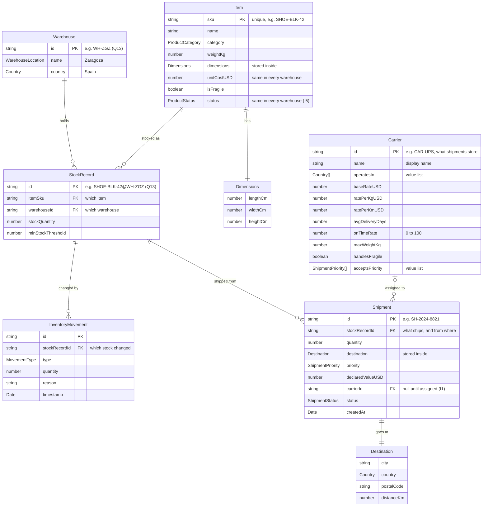

# Warehouse logic: entity relationship diagram

> **Status**: Draft for mae's agreement (plan WP1), updated with mae's answers to Q1 and Q10 (2026-11-17). Nothing in `src/` is written until mae agrees.
> **Source**: `docs/milestones/milestone-2/trackflow-BRIEFING.en.md`, "Business Entities". Every entity, field, type and value below is copied from it. Where the briefing left something open, the diagram follows mae's answer (`docs/decisions.md`, "Milestone 2's open questions answered").

## The diagram

Each box is one interface from the briefing, listing its fields in the briefing's order. `PK` (primary key) marks the field or fields that identify a record: no two records share them. `FK` (foreign key) marks a field that points to another record's key. Lines show how records refer to each other. Their ends read: `||` exactly one, `|o` zero or one, `o{` zero or more.

A product's key has two parts, `sku` and `warehouse`, because the same SKU can be stocked in both warehouses (Q10). So a shipment needs two fields to point at one product, its `sku` and its `origin`, and an inventory movement needs its `sku` and its `warehouse`. The notes "part 1 of 2" and "part 2 of 2" mark those pairs.

`Dimensions` and `Destination` are not separate records. They are objects stored inside a product or a shipment, drawn as boxes only so their fields can be seen.

The `ProductKey` box, with no lines, is a type, not a stored record: the pair `{ sku, warehouse }` the code reads from a product (`sku`, `warehouse`), a shipment (`sku`, `origin`) or an inventory movement (`sku`, `warehouse`). `toProductCode` turns a key into one string, in the format of open question Q13 (for example `SHOE-BLK-42@WH-ZGZ`), and `parseProductCode` turns the string back. The code is always derived and never stored, so it can't drift from the fields it comes from. The brief's interfaces stay exactly as written.

### Editing the diagrams

Both diagrams are Mermaid code in this file, which GitHub draws (`docs/decisions.md`, "The Milestone 2 ERD is Mermaid in `erd.md`"). To try a change with a live preview, paste a block into https://mermaid.live. To make one, edit the block here or ask a Claude thread. When a diagram changes, the text and tables around it change in the same commit.

## Improved model (planned)

This is mae's design (2026-11-17), built after the brief's model as improvement I4 in the plan. Its goal is a system of single ids with no two-part keys. The brief's `Product` mixes the item with its stock in one warehouse, so the model splits them:

- **`Item`**: one record per SKU, so the SKU is unique and serves as the item's id. It holds everything that is the same in every warehouse, which includes `unitCostUSD` and `status` by mae's answers to Q11 and Q12.
- **`Warehouse`**: one record per warehouse with its own `id`, its `name` (the briefing's `WarehouseLocation`) and its `country`.
- **`StockRecord`**: one record per item per warehouse, with its own `id`. It points at its item (`itemSku`) and its warehouse (`warehouseId`), and holds the stock: `stockQuantity` and `minStockThreshold`. This is the ProductId mae described: one code that names a SKU in one warehouse.
- **`Shipment`** points at the stock it ships with one `stockRecordId`, in place of `sku` and `origin`. **`InventoryMovement`** does the same in place of `sku` and `warehouse`. A shipment also points at its carrier by `carrierId` (improvement I1).

Every link is one id pointing at one id. Items and warehouses meet only through `StockRecord`, so the model has no many-to-many link. A rule keeps one stock record per item per warehouse. If the stock record's id is built from the SKU and the warehouse id (Q13), that rule holds by construction.

The briefing's interfaces and functions still work: functions rebuild the brief's `Product` (one item, plus one stock record, plus its warehouse's name) and `Shipment` (its `sku` and `origin` read through the stock record) from these records.

`Carrier.operatesIn` and `Carrier.acceptsPriority` are many-to-many in principle, linking carriers to countries and to priorities. Both are lists of fixed values that the briefing requires inside the carrier, so they stay as lists, marked "value list" in both diagrams.

A status per warehouse (for example "Low stock" in Zaragoza only) is improvement I5.

## Q1 (was D3): `Shipment.carrier` holds the carrier's name

The briefing gives a carrier two strings, `id` (`"CAR-UPS"`) and `name` (`"UPS"`), and gives a shipment a single `carrier: string | null`. Here are both options, with the briefing's sample carrier `UPS` (id `CAR-UPS`) and shipment `SH-2024-8821`.

`findTopCarriers(shipments, topN)` is given only shipments, so it can return only what the shipments hold. Under (b) it has no way to look up a name.

| | (a) name | (b) id |
|---|---|---|
| The shipment stores | `carrier: "UPS"` | `carrier: "CAR-UPS"` |
| `findTopCarriers` returns | names, as the briefing says | ids |
| If a carrier is renamed | old shipments keep the old name | nothing changes |
| Readable in raw data | yes | less |

mae chose (a) on 2026-11-17, because it is the only option under which the briefing's function works as written. Moving to (b) is tracked as improvement I1 in the plan: a renamed carrier would otherwise show up as two carriers in `findTopCarriers`, with its old shipments under the old name. That improvement would keep ids in shipments and look names up from the carriers list.

## Q10: a product is identified by its SKU and warehouse

The briefing gives each product one `warehouse`, and TrackFlow keeps stock in both Los Angeles and Zaragoza (`CONTEXT.md`, Warehouse Operations). The same SKU stocked in both warehouses is therefore two product records with the same `sku`. A shipment names both `sku` and `origin`, and an inventory movement names both `sku` and `warehouse`. Those pairs only point at one product if a product is identified by its SKU and warehouse together, which is what mae chose on 2026-11-17. `findProductBySKU` keeps the briefing's signature and returns the first match. A lookup that returns a SKU's record in every warehouse is tracked as improvement I3.

## Allowed values

Copied from the briefing's literal types.

| Type | Values |
|---|---|
| `ProductCategory` | `"Fashion"`, `"Electronics"`, `"Cosmetics"`, `"Home"`, `"Other"` |
| `WarehouseLocation` | `"Los Angeles"`, `"Zaragoza"` |
| `ProductStatus` | `"Active"`, `"Low stock"`, `"Out of stock"`, `"Discontinued"` |
| `Country` | `"United States"`, `"Spain"` |
| `ShipmentPriority` | `"Standard"`, `"Express"`, `"Same-day"` |
| `ShipmentStatus` | `"Pending"`, `"Assigned"`, `"In transit"`, `"Delivered"`, `"Failed"` |
| `MovementType` | `"Inbound"`, `"Outbound"`, `"Transfer"`, `"Adjustment"` |

## Validation rules

The briefing's 14 rules. These are the only rules built first (plan D7). Proposed improvements come later, in plan WP8.

| Entity | Rule |
|---|---|
| Product | `sku` must not be empty |
| Product | `weightKg` must be > 0 and <= 100 |
| Product | all dimensions must be > 0 and <= 200 |
| Product | `stockQuantity` must be >= 0 |
| Product | `minStockThreshold` must be >= 0 |
| Product | `unitCostUSD` must be > 0 |
| Shipment | `quantity` must be > 0 |
| Shipment | `declaredValueUSD` must be > 0 |
| Shipment | `destination.distanceKm` must be >= 0 |
| Carrier | `baseRateUSD`, `ratePerKgUSD` and `ratePerKmUSD` must all be >= 0 |
| Carrier | `avgDeliveryDays` must be > 0 |
| Carrier | `onTimeRate` must be between 0 and 100 |
| Carrier | `maxWeightKg` must be > 0 |
| Carrier | `operatesIn` must contain at least 1 country |

`InventoryMovement` has no rules in the briefing.

## What the diagram does not decide

The answers about function behaviour (Q2 to Q9) are in `docs/decisions.md`. Nothing the briefing lacks has been added here: there are no new fields, no new entities and no warehouse or client records.
