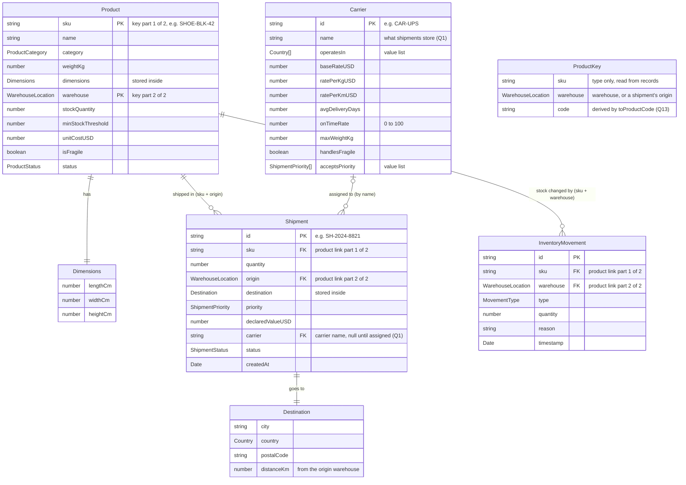
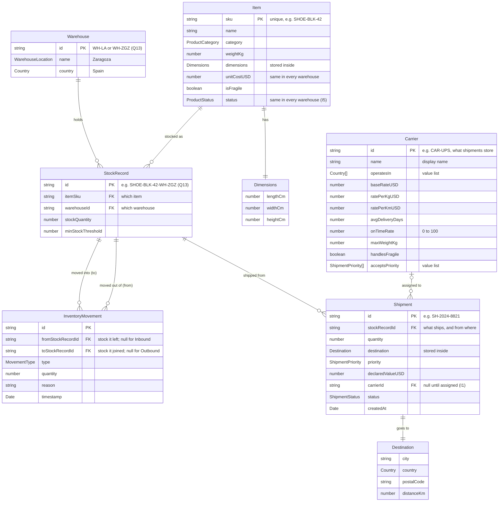

# Warehouse logic: entity relationship diagram

> **Status**: Draft for mae's agreement (plan WP1), updated with mae's answers to Q1 and Q10 (2026-11-17). Nothing in `src/` is written until mae agrees.
> **Source**: `docs/milestones/milestone-2/trackflow-BRIEFING.en.md`, "Business Entities". Every entity, field, type and value below is copied from it. Where the briefing left something open, the diagram follows mae's answer (`docs/decisions.md`, "Milestone 2's open questions answered").

## The diagram

Each box is one interface from the briefing, listing its fields in the briefing's order. `PK` (primary key) marks the field or fields that identify a record: no two records share them. `FK` (foreign key) marks a field that points to another record's key. Lines show how records refer to each other. Their ends read: `||` exactly one, `|o` zero or one, `o{` zero or more.

A product's key has two parts, `sku` and `warehouse`, because the same SKU can be stocked in both warehouses (Q10). So a shipment needs two fields to point at one product, its `sku` and its `origin`, and an inventory movement needs its `sku` and its `warehouse`. The notes "part 1 of 2" and "part 2 of 2" mark those pairs.

`Dimensions` and `Destination` are not separate records. They are objects stored inside a product or a shipment, drawn as boxes only so their fields can be seen.

The `ProductKey` box, with no lines, is a type, not a stored record: the pair `{ sku, warehouse }` the code reads from a product (`sku`, `warehouse`), a shipment (`sku`, `origin`) or an inventory movement (`sku`, `warehouse`). `toProductCode` turns a key into one string, in the format mae chose for Q13: the SKU, a hyphen, then the warehouse id (for example `SHOE-BLK-42-WH-ZGZ`), and `parseProductCode` turns the string back. The code is always derived and never stored, so it can't drift from the fields it comes from. The brief's interfaces stay exactly as written.

### Editing the diagrams

Both diagrams are Mermaid code in this file, which GitHub draws (`docs/decisions.md`, "The Milestone 2 ERD is Mermaid in `erd.md`"). To try a change with a live preview, paste a block into https://mermaid.live. To make one, edit the block here or ask a Claude thread. When a diagram changes, the text and tables around it change in the same commit.

## Improved model (planned)

This is mae's design (2026-11-17), built after the brief's model as improvement I4 in the plan. Its goal is a system of single ids with no two-part keys. The brief's `Product` mixes the item with its stock in one warehouse, so the model splits them:

- **`Item`**: one record per SKU, so the SKU is unique and serves as the item's id. It holds everything that is the same in every warehouse, which includes `unitCostUSD` and `status` by mae's answers to Q11 and Q12.
- **`Warehouse`**: one record per warehouse with its own `id`, its `name` (the briefing's `WarehouseLocation`) and its `country`.
- **`StockRecord`**: one record per item per warehouse, with its own `id`. It points at its item (`itemSku`) and its warehouse (`warehouseId`), and holds the stock: `stockQuantity` and `minStockThreshold`. This is the ProductId mae described: one code that names a SKU in one warehouse.
- **`Shipment`** points at the stock it ships with one `stockRecordId`, in place of `sku` and `origin`. **`InventoryMovement`** says where stock came from and went to, in place of `sku` and `warehouse`: `fromStockRecordId` and `toStockRecordId` (mae, 2026-11-18). An Inbound movement has only a `to`, an Outbound only a `from`, a Transfer both (the same item in two different warehouses), and an Adjustment one of them. Each points at a stock record, which names both the item and the warehouse, so the warehouses are reached through it and are never stored twice.A shipment also points at its carrier by `carrierId` (improvement I1).