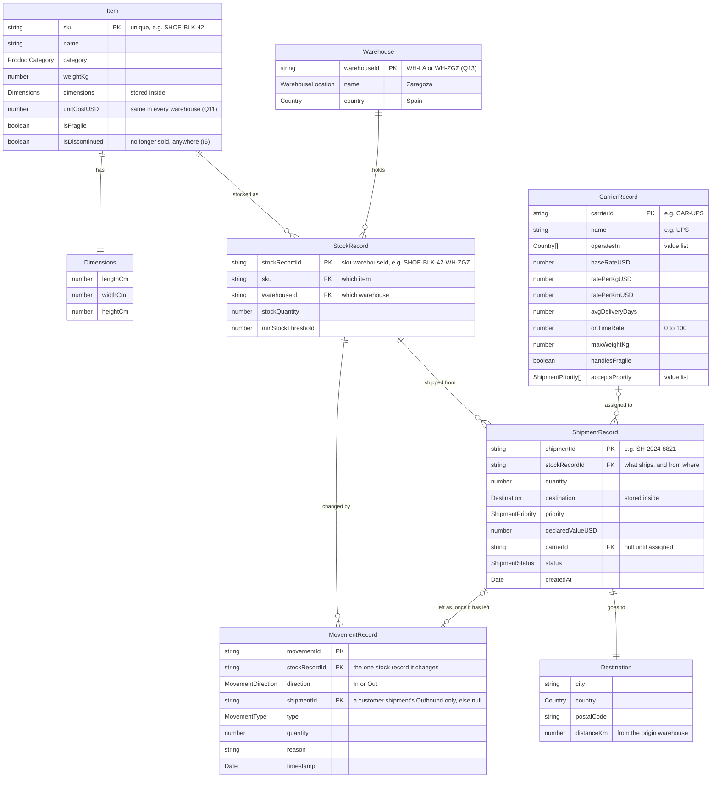

# Warehouse logic: entity relationship diagram

> **Status**: Agreed by mae (2026-11-18). It is the stored structure, with the brief's interfaces as views, a departure from the brief logged in `docs/decisions.md` ("Milestone 2 stores single-id records, with the brief's interfaces as views"). A review the same day named the stored carrier `CarrierRecord` and set the movement shapes out as a table. mae then changed how a movement is stored (Q19, 2026-11-18): one stock record and a `direction` for each movement, in place of a `from`, a `to` and a `transferId` (`docs/decisions.md`, "A movement is one warehouse's record of a change to its own stock"). On 2026-11-19 mae chose to work a product's status out per warehouse (I5): `Item.status` became `Item.isDiscontinued` (`docs/decisions.md`, "WP8b's tracked improvements decided").
> **Source**: `docs/milestones/milestone-2/trackflow-BRIEFING.en.md`, "Business Entities", and mae's design (2026-11-17 and 2026-11-18). Every business field and value comes from the briefing, and the new records (`Item`, `Warehouse`, `StockRecord`) regroup them. What the model adds is its own keys and links: the warehouse id, in mae's format (Q13), `stockRecordId`, and on a movement `direction` and `shipmentId`; and `Item.isDiscontinued` (I5, 2026-11-19), the one part of the briefing's `ProductStatus` that is not about stock. `Warehouse.country` is the briefing's "United States (Los Angeles) and Spain (Zaragoza)".

## The diagram

How the data is stored. Every record has one id, and every link is one id pointing at one id.

How to read it: `PK` (primary key) marks the field that identifies a record, so no two records share it. Each is named for what it identifies (`warehouseId`, `shipmentId`), and the SKU is the item's. `FK` (foreign key) marks a field that holds another record's key, and has that key's name. The ends of each line read `||` exactly one, `|o` zero or one, and `o{` zero or more. `Dimensions` and `Destination` are not separate records: they are objects stored inside an item or a shipment, drawn as boxes only so their fields can be seen.

## The records

- **`Item`**: one per SKU, so the SKU is unique and is the item's key (`sku`). SKUs are stored upper case, so keys compare exactly (Q17). It holds everything that is the same in every warehouse. By mae's answers that includes `unitCostUSD` (Q11) and whether the item is discontinued, `isDiscontinued`. It stores no status: each warehouse's status is worked out from its stock (I5, below).
- **`Warehouse`**: one per warehouse, with a `warehouseId` in the carriers' style (`WH-LA`, `WH-ZGZ`), its `name` (the briefing's `WarehouseLocation`) and its `country`.
- **`StockRecord`**: one per item per warehouse. It holds the stock (`stockQuantity`, `minStockThreshold`). Its `stockRecordId` is the SKU, a hyphen, then the `warehouseId` (Q13), so the same item can never have two records in one warehouse. SKUs contain hyphens too, so an id is split by matching the known warehouse id at its end. This is the ProductId mae described.
- **`ShipmentRecord`**: a shipment (`shipmentId`), pointing at the stock it ships from (`stockRecordId`) and at its carrier by id (`carrierId`), so renaming a carrier changes nothing (improvement I1, now part of the design).
- **`MovementRecord`**: one warehouse's own record of a change to its own stock (`movementId`), mae's design (Q19). It points at the one stock record it changes (`stockRecordId`) and says which way with `direction`: `"In"` for units that joined that stock, `"Out"` for units that left it. It does not say where the units came from or where they are headed. An Inbound is always In and an Outbound always Out; a Transfer or an Adjustment can be either. A shipment is a delivery to a customer, and when it leaves, its warehouse writes an Outbound that holds the `shipmentId` of the order the units left for. That is how a shipment that has left is matched to its movement; a shipment that is Pending or Assigned has none yet, and no other movement has a `shipmentId`. A transfer between warehouses is not a shipment. It is two movements, an Out written by the sending warehouse and an In written by the receiving one (Q14), each with its own `quantity` and `timestamp`. Nothing links the two, so this model cannot check that what was sent arrived, or count units in transit. A `transferId` that does that is parked in `docs/FUTURE_WORK.md`.
- **`CarrierRecord`**: the briefing's `Carrier`, except that its key is named `carrierId`. It has its own name because the brief's `Carrier` interface keeps that one, and both are types in the code.

The six movements a warehouse can write:

| What happened at the warehouse | `type` | `direction` | `shipmentId` | Effect on its stock record |
|---|---|---|---|---|
| Stock arrives from outside the organization | Inbound | In | null | adds |
| A customer shipment leaves | Outbound | Out | that shipment's | takes |
| Stock is sent to the other warehouse | Transfer | Out | null | takes |
| Stock arrives from the other warehouse | Transfer | In | null | adds |
| A count is corrected upward | Adjustment | In | null | adds |
| A count is corrected downward | Adjustment | Out | null | takes |

Every movement changes exactly one stock record, so a stock record's movements are what came in and what went out of it, and a movement's warehouse is always the warehouse that wrote it. The direction is in `direction`, so `quantity` stays the briefing's "number of units moved".

Items and warehouses meet only through `StockRecord`, so there is no many-to-many link. `CarrierRecord.operatesIn` and `CarrierRecord.acceptsPriority` link carriers to countries and to priorities. Both are lists of fixed values that the briefing requires inside the carrier, so they stay as lists.

## The brief's interfaces, as views

The briefing's interfaces are kept in `src/types/models.ts` exactly as written, because they are graded field for field and every briefing function takes them. They are not stored. Functions build them from the records above, and the briefing's functions work on them unchanged.

| Brief interface | Built from |
|---|---|
| `Product` | An `Item`, plus one of its `StockRecord`s for `stockQuantity` and `minStockThreshold`, plus that record's `Warehouse` `name` for `warehouse`. One `Product` for each item in each warehouse. Its `status` is worked out (I5): `"Discontinued"` when the item is, else `"Out of stock"` at 0 units or fewer, else `"Low stock"` when the stock is at or below its threshold, else `"Active"` (`productStatusOf`). |
| `Shipment` | A `ShipmentRecord`, with `id` its `shipmentId`, `sku` and `origin` read through its stock record (the item's SKU and the warehouse's name), and `carrier` the carrier's `name` (Q1) or `null`. |
| `InventoryMovement` | A `MovementRecord`, with `id` its `movementId`, and `sku` and `warehouse` read through its stock record (the item's SKU and the warehouse's name). `direction` and `shipmentId` are not in the view. A transfer therefore shows as one Transfer at the sending warehouse and another at the receiving one (Q14). |
| `Carrier` | A `CarrierRecord`, with `id` its `carrierId`. |
| `Dimensions`, `Destination` | Unchanged. |

The brief's `InventoryMovement` has no field for direction. A transfer out and a transfer in both read `"Transfer"`, and an adjustment up and an adjustment down both read `"Adjustment"`, so which way the stock moved can only be told from the stored record's `direction`.

A product in the views is named by its SKU and warehouse together (Q10). `buildStockRecordId` builds the matching stock record id from them (Q20), and `parseStockRecordId` turns an id back into the two.

### Editing the diagram

The diagram is Mermaid code in this file, which GitHub draws (`docs/decisions.md`, "The Milestone 2 ERD is Mermaid in `erd.md`"). To try a change with a live preview, paste the block into https://mermaid.live. To make one, edit the block here or ask a Claude thread. When the diagram changes, the text and tables around it change in the same commit.

## Allowed values

Copied from the briefing's literal types.

| Type | Values |
|---|---|
| `ProductCategory` | `"Fashion"`, `"Electronics"`, `"Cosmetics"`, `"Home"`, `"Other"` |
| `WarehouseLocation` | `"Los Angeles"`, `"Zaragoza"` |
| `ProductStatus` | `"Active"`, `"Low stock"`, `"Out of stock"`, `"Discontinued"` |
| `Country` | `"United States"`, `"Spain"` |
| `ShipmentPriority` | `"Standard"`, `"Express"`, `"Same-day"` |
| `ShipmentStatus` | `"Pending"`, `"Assigned"`, `"In transit"`, `"Delivered"`, `"Failed"` |
| `MovementType` | `"Inbound"`, `"Outbound"`, `"Transfer"`, `"Adjustment"` |

`MovementDirection`, `"In"` or `"Out"`, is not a briefing type. It is the model's own, for `MovementRecord.direction` (Q19).

## Validation rules

The briefing's 14 rules, checked on the brief's interfaces (the views above). These are the only rules built first (plan D7). Proposed improvements come later, in plan WP8.

| Entity | Rule |
|---|---|
| Product | `sku` must not be empty |
| Product | `weightKg` must be > 0 and <= 100 |
| Product | all dimensions must be > 0 and <= 200 |
| Product | `stockQuantity` must be >= 0 |
| Product | `minStockThreshold` must be >= 0 |
| Product | `unitCostUSD` must be > 0 |
| Shipment | `quantity` must be > 0 |
| Shipment | `declaredValueUSD` must be > 0 |
| Shipment | `destination.distanceKm` must be >= 0 |
| Carrier | `baseRateUSD`, `ratePerKgUSD` and `ratePerKmUSD` must all be >= 0 |
| Carrier | `avgDeliveryDays` must be > 0 |
| Carrier | `onTimeRate` must be between 0 and 100 |
| Carrier | `maxWeightKg` must be > 0 |
| Carrier | `operatesIn` must contain at least 1 country |

`InventoryMovement` has no rules in the briefing.

## What the diagram does not decide

The answers about function behaviour (Q2 to Q9) are in `docs/decisions.md`, and open questions are in `docs/open-questions.md`. None of the open ones changes this model.
