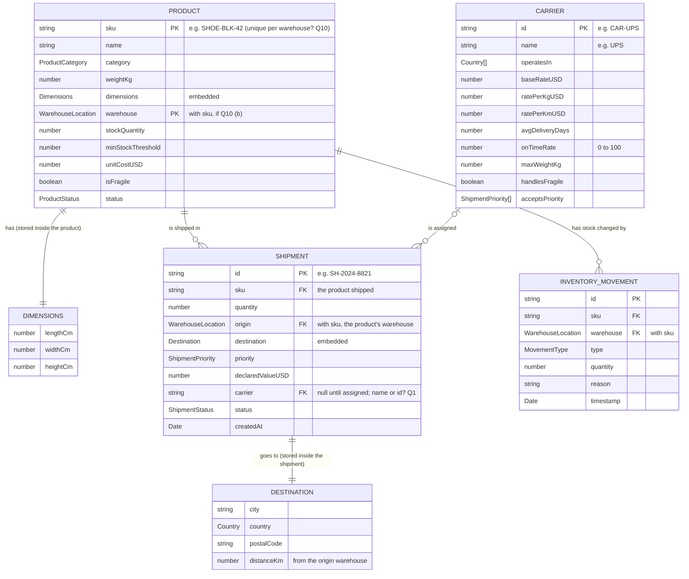
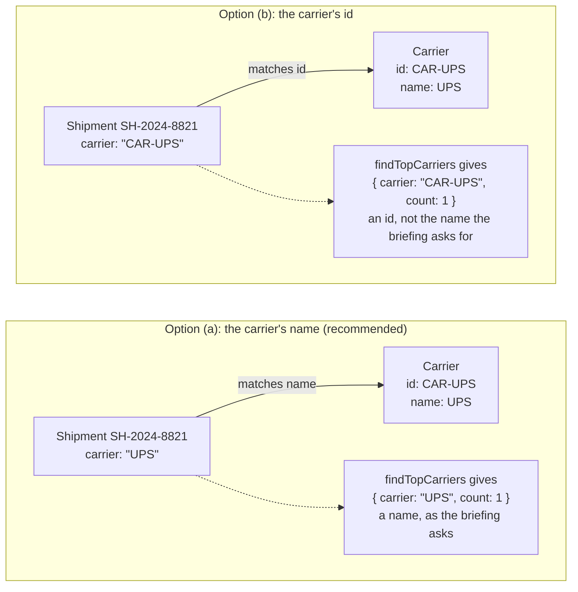

# Warehouse logic: entity relationship diagram

> **Status**: Draft for mae's agreement (plan WP1). Nothing in `src/` is written until mae agrees.
> **Source**: `docs/milestones/milestone-2/trackflow-BRIEFING.en.md`, "Business Entities". Every entity, field, type and value below is copied from it. Where the briefing leaves something open, the diagram marks it and points to `docs/open-questions.md`.

## The diagram

Each box is one interface from the briefing. The boxes list the fields in the briefing's order. `PK` marks the field that identifies a record and `FK` marks a field that points to another record. Lines show how records refer to each other.

How to read the lines: `||` means exactly one, `o{` means zero or more, and `|o` means zero or one. So a product appears in zero or more shipments, and a shipment has zero carriers (`carrier: null`, not assigned yet) or one.

`DIMENSIONS` and `DESTINATION` are not separate records. They are objects stored inside a product or a shipment, drawn as boxes only so their fields can be seen.

## Q1 (was D3): what does `Shipment.carrier` hold?

The briefing gives a carrier two strings, `id` (`"CAR-UPS"`) and `name` (`"UPS"`), and gives a shipment a single `carrier: string | null`. Both options are drawn below, with the briefing's sample carrier.

`findTopCarriers(shipments, topN)` is given only shipments, so it can return only what the shipments hold. Under (b) it has no way to look up a name.

| | (a) name | (b) id |
|---|---|---|
| `findTopCarriers` returns | names, as the briefing says | ids |
| If a carrier is renamed | old shipments keep the old name | nothing changes |
| Readable in raw data | yes | less |

The recommendation is (a), because it is the only option under which the briefing's function works as written. The weakness on renames can go into the improvement reviews later.

## Q10 (new): what identifies a product?

The briefing gives each product one `warehouse`, and TrackFlow keeps stock in both Los Angeles and Zaragoza (`CONTEXT.md`, Warehouse Operations). The same SKU stocked in both warehouses is therefore two product records with the same `sku`. A shipment names both `sku` and `origin`, and an inventory movement names both `sku` and `warehouse`. Those pairs only point at one product if a product is identified by its SKU and warehouse together. `findProductBySKU`, though, returns a single product for a SKU. The question is in `docs/open-questions.md`, Q10.

## Allowed values

Copied from the briefing's literal types.

| Type | Values |
|---|---|
| `ProductCategory` | `"Fashion"`, `"Electronics"`, `"Cosmetics"`, `"Home"`, `"Other"` |
| `WarehouseLocation` | `"Los Angeles"`, `"Zaragoza"` |
| `ProductStatus` | `"Active"`, `"Low stock"`, `"Out of stock"`, `"Discontinued"` |
| `Country` | `"United States"`, `"Spain"` |
| `ShipmentPriority` | `"Standard"`, `"Express"`, `"Same-day"` |
| `ShipmentStatus` | `"Pending"`, `"Assigned"`, `"In transit"`, `"Delivered"`, `"Failed"` |
| `MovementType` | `"Inbound"`, `"Outbound"`, `"Transfer"`, `"Adjustment"` |

## Validation rules

The briefing's 14 rules. These are the only rules built first (plan D7). Proposed improvements come later, in plan WP8.

| Entity | Rule |
|---|---|
| Product | `sku` must not be empty |
| Product | `weightKg` must be > 0 and <= 100 |
| Product | all dimensions must be > 0 and <= 200 |
| Product | `stockQuantity` must be >= 0 |
| Product | `minStockThreshold` must be >= 0 |
| Product | `unitCostUSD` must be > 0 |
| Shipment | `quantity` must be > 0 |
| Shipment | `declaredValueUSD` must be > 0 |
| Shipment | `destination.distanceKm` must be >= 0 |
| Carrier | `baseRateUSD`, `ratePerKgUSD` and `ratePerKmUSD` must all be >= 0 |
| Carrier | `avgDeliveryDays` must be > 0 |
| Carrier | `onTimeRate` must be between 0 and 100 |
| Carrier | `maxWeightKg` must be > 0 |
| Carrier | `operatesIn` must contain at least 1 country |

`InventoryMovement` has no rules in the briefing.

## What the diagram does not decide

The open questions about function behaviour are in `docs/open-questions.md`. Nothing the briefing lacks has been added here: there are no new fields, no new entities and no warehouse or client records.
