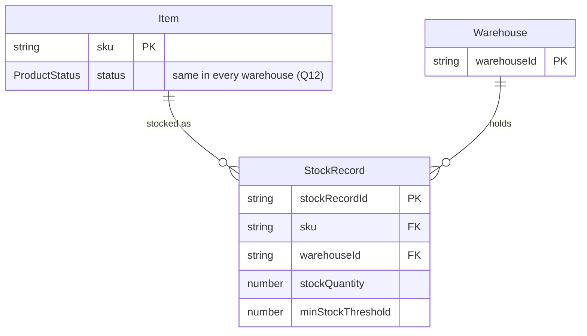
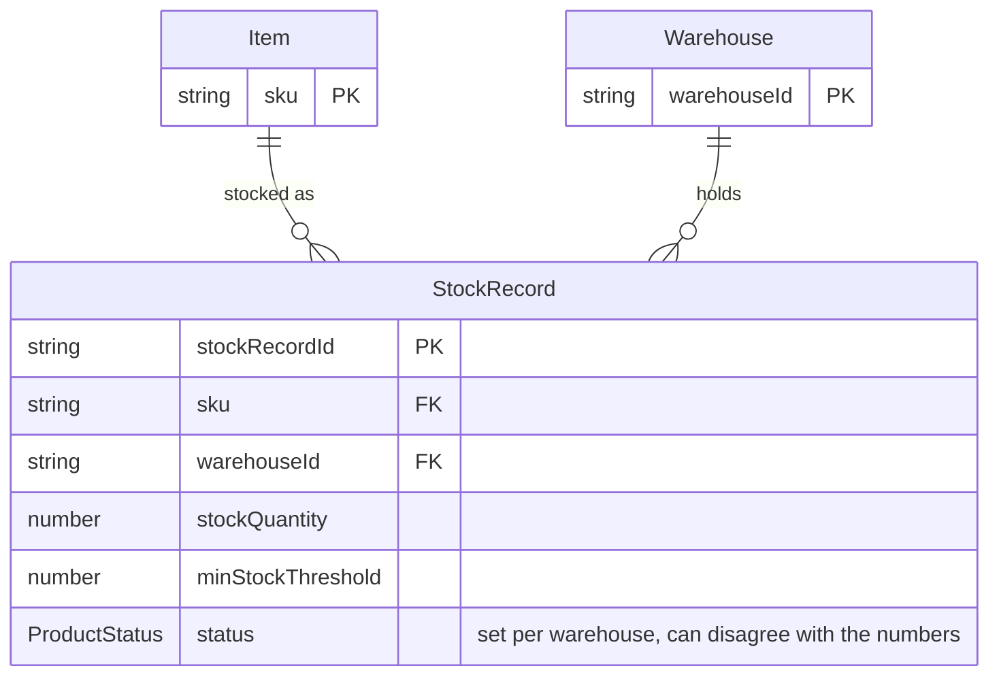
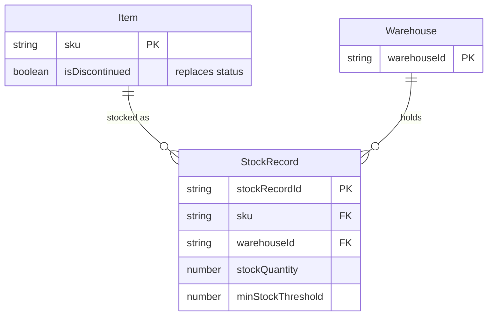
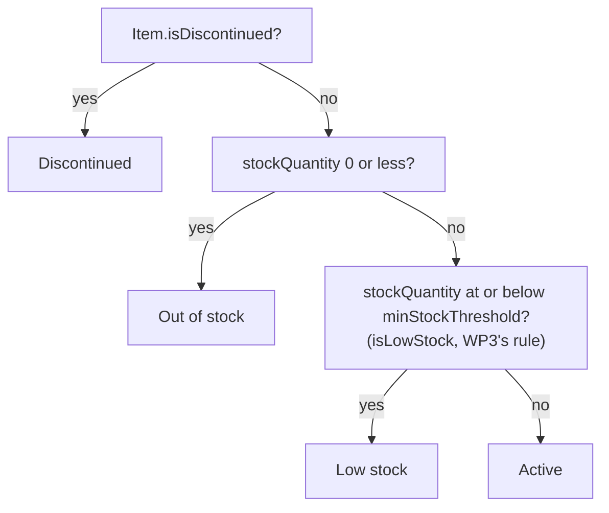

# Tracked improvements: I2, I3 and I5, with WP2's P1 and P2

> **Status**: analysis for mae, 2026-11-19, answered by mae the same day ("mae's answers", below;
> `docs/decisions.md`, "WP8b's tracked improvements decided"). P2, I3 and P1 are built (PR #44,
> `tests/search-improved.test.ts`); I5 in its own pull request (`tests/views-status.test.ts`). Plan WP8b
> (`docs/milestones/milestone-2/plan.md`, "Phase 4").
> **Rule for all five**: the briefing's interfaces and functions stay exactly as they are. Whatever mae
> approves is built beside them, under new names, and logged in `docs/decisions.md` as a departure.
> Code starts after WP6 merges, and I5 merges last of the Phase 4 packages.

## How to answer

There are five decisions, each with its own options. You can approve every recommendation at once, or
name the ones to change.

| # | Improvement | Recommendation | Changes tests already on `production`? |
|---|---|---|---|
| 1 | I2: binary search that finds the first match, and a weight range | (b) first match and weight range, built on two shared "bound" searches | No |
| 2 | P2: check that a list is sorted before a binary search | (a) one helper, `isSortedBy` | No |
| 3 | I3: find a SKU in every warehouse | (b) every warehouse's product, plus the exact product for a SKU and warehouse | No |
| 4 | P1: the views use `indexBy` instead of their own copy | (b) one copy, and SKU normalizing moves so the two files don't import each other | No |
| 5 | I5: a status for each warehouse | (c) work out the stock part of the status from the numbers, and store only "discontinued" on the item | Yes: three test files, through drafts and your `allow-test-changes` label |

Decisions 1 to 4 would ship together in one pull request (`search.ts`, `views.ts`, one new test file).
Decision 5 gets its own pull request, last.

### mae's answers (2026-11-19)

| # | Answer | What gets built |
|---|---|---|
| 1 | I2: no change now; (a) parked for later | Nothing. `docs/FUTURE_WORK.md`, "Binary search that returns the first matching index" |
| 2 | P2: (a) | `isSortedBy(items, keyOf)` |
| 3 | I3: (a), overloaded with (b) | `findProductsBySKU(products, sku)` gives every warehouse's product; `findProductsBySKU(products, sku, warehouse)` gives the one product, or `null` |
| 4 | P1: (b) | The views use `indexBy`; `normalizeSku` moves to `search.ts`, re-exported from `views.ts` |
| 5 | I5: (c) | `Item.isDiscontinued` replaces `Item.status`; the views work out `Product.status` |

The sections below are the analysis as mae read it. The function names in them for decision 3, option
(b), are replaced by the overload above.

---

## 1. I2: the first matching index, and a weight range

### Why

`binarySearchProductByWeight` returns any index whose product has the target weight, as the briefing
says ("a product") and as you answered Q9. Equal weights sit side by side in a sorted list, so the
search can land on any of them.

The case in practice: a SKU stocked in both warehouses is two products with the same weight. WP2's
timing run found binary search returning the other warehouse's product, where linear search and the
`Map` returned the first one listed (`docs/search-research.md`, "Timing run"). On the seeded mock data
(seed 20261118, 1,000 items, 1,242 products), 353 of the 623 weights belong to more than one product,
and for 193 of those the search returned an index that is not the first.

Weights are also decimals, and the search compares them exactly: `0.1 + 0.2` is
`0.30000000000000004` in JavaScript, so a search for it misses the 0.3 kg perfume. A range search
avoids that.

### Options

- **(a) First match only.** `binarySearchFirstProductByWeight(sortedProducts, targetWeight)`: the
  lowest index with that weight, or -1.
- **(b) First match and a weight range.** (a), plus
  `findProductsByWeightRange(sortedProducts, minKg, maxKg)`: every product from `minKg` to `maxKg`,
  both ends included, in the list's order. Both are built on two generic blocks that the
  binary search tools share:
  - `firstIndexAtOrAbove(sortedItems, target, keyOf)`: the first index whose key is at least the
    target, or the list's length when none is.
  - `firstIndexAbove(sortedItems, target, keyOf)`: the first index whose key is greater than the
    target, or the list's length.

  The first match is `firstIndexAtOrAbove`, checked for equality. The range is the slice from
  `firstIndexAtOrAbove(min)` up to `firstIndexAbove(max)`. Python's `bisect_left` and `bisect_right`
  and C++'s `lower_bound` and `upper_bound` are the same two searches; the names here say what each
  returns, as your naming rule asks.
- **(c) (b), plus the last match and a count.** The last match is `firstIndexAbove(target) - 1`, and
  the count of products of a weight is the difference of the two bounds. Each is a line once (b)
  exists.

Each bound reads at most ⌈log₂(n + 1)⌉ keys (Knuth, 6.2.1), so 11 for 1,024 products. A range costs
two bounds plus copying what it returns.

Worth knowing: WP3 already finds a weight range by linear search on a list in any order,
`filterProducts(products, { weightKg: { min, max } })`. The binary range adds speed on a list kept
sorted by weight, not a new answer. In WP2's timing run, binary search took about 1 µs on 100,000
products where linear search took about 400 µs.

### Recommendation

**(b).** The first match fixes the Q9 case, and the range is the question binary search answers best
(`docs/search-research.md`, "Fits"). Building both on the two bounds keeps the halving logic in one
place. (c) can be added later in a line each, if a caller needs it.

### Before and after

The list below is the briefing's three items, each stocked in both warehouses, sorted by weight. The
second warehouse of each is made up for the example (MOCK), not company data.

| Index | Product | Weight |
|---:|---|---:|
| 0 | PERFUME-COCO-50, Los Angeles | 0.3 kg |
| 1 | SHOE-BLK-42, Los Angeles | 0.8 kg |
| 2 | SHOE-BLK-42, Zaragoza (MOCK) | 0.8 kg |
| 3 | LAPTOP-DELL-15, Zaragoza | 2.3 kg |
| 4 | LAPTOP-DELL-15, Los Angeles (MOCK) | 2.3 kg |

| Call | Today | After |
|---|---|---|
| `binarySearchProductByWeight(list, 0.8)` | 2, the Zaragoza shoes (the middle of five is checked first) | 2, unchanged: the briefing's function stays |
| `binarySearchFirstProductByWeight(list, 0.8)` | (doesn't exist) | 1, the Los Angeles shoes |
| `findProductsByWeightRange(list, 0.5, 2.5)` | (doesn't exist) | indexes 1 to 4: both shoes, both laptops |
| `findProductsByWeightRange(list, 0.29, 0.31)` | (doesn't exist) | the perfume, which `binarySearchProductByWeight(list, 0.1 + 0.2)` misses (-1) |

Edges the tests would pin: an empty list gives -1 and `[]`; `minKg` above `maxKg` gives `[]`; a
range with no product in it gives `[]`; a bound of `NaN` gives `[]`.

### Cost

Four exports in `search.ts`, about 30 tests in a new file, low risk tier like WP2.

---

## 2. P2: check that a list is sorted

### Why

Binary search trusts that its list is sorted by the key. On any other order it throws away the half
holding the answer and returns -1 for a product that is there. The briefing's own sample list shows
it: `sampleProducts` is in the order shoes (0.8 kg), laptop (2.3 kg), perfume (0.3 kg), and
`binarySearchProductByWeight(sampleProducts, 0.3)` gives -1, though the perfume is at index 2.

### Options

- **(a) A helper.** `isSortedBy(items, keyOf)`: true when every key is at most the next one
  (ascending, so equal keys are fine). An empty or one-item list is sorted. A `NaN` key makes it
  false, which is right, because binary search can't place `NaN` either. It reads `n - 1` pairs, so a
  caller checks once before many searches, and the test page can show a warning.
- **(b) The helper, plus checked searches** that check the order on every call and return the result
  with a warning, like `groupByListedKeys`. Each check costs as much as a linear search, which removes
  the reason to use binary search.
- **(c) Leave it out.** Callers sort first, as the briefing's signature (`sortedProducts`) asks.

### Recommendation

**(a).** It fits "grace, but flagged" at the point where checking is cheap: once per list, not once
per search.

### Before and after

| Call | Today | After |
|---|---|---|
| `binarySearchProductByWeight(sampleProducts, 0.3)` | -1 | -1, unchanged |
| `isSortedBy(sampleProducts, (p) => p.weightKg)` | (doesn't exist) | `false`: sort before searching |
| `isSortedBy(the list in decision 1, (p) => p.weightKg)` | (doesn't exist) | `true` |

### Cost

One export in `search.ts`, about 8 tests in the same new file.

---

## 3. I3: a SKU in every warehouse

### Why

You answered Q10 that a product is a SKU in one warehouse, and `findProductBySKU` returns the first one
listed. A SKU stocked in both warehouses then shows only one warehouse's stock. `CONTEXT.md` says
TrackFlow needs "real-time stock for any SKU in either warehouse". On the mock data, 242 of the 1,000
SKUs are stocked in both warehouses.

### Options

- **(a) Every warehouse's product.** `findProductsBySKU(products, sku)`: every product with that SKU,
  case ignored, in the list's order, `[]` when none. Linear, so the list can be in any order. It shares
  one SKU test with `findProductBySKU`, so the matching rule lives in one place.
- **(b) (a), plus the exact product.** `findProductBySKUAndWarehouse(products, sku, warehouse)`: the
  one product Q10 says a SKU and a warehouse identify, or `null`. The SKU ignores case; the warehouse
  is one of the two `WarehouseLocation` values.
- **(c) (b), plus a stock summary.** `summarizeStockBySKU(products, sku)`: the total units and the
  units in each warehouse, every warehouse listed, with 0 where the SKU isn't stocked. This is close to
  the "unified inventory API" `CONTEXT.md` describes, which belongs to a later milestone.

For many lookups in the same list, WP3's `groupBy(products, (p) => normalizeSku(p.sku))` already gives
every SKU's products in one pass, so no new function is needed for that. The README would show it.

### Recommendation

**(b).** (a) is the improvement you asked to track, and (b) gives Q10's identity a function of its own.
(c) would go in `docs/FUTURE_WORK.md`, for the milestone that builds the inventory API.

### Before and after

The Zaragoza shoes are MOCK, made up for the example.

| Call | Today | After |
|---|---|---|
| `findProductBySKU(products, "shoe-blk-42")` | Los Angeles shoes, 45 units | the same, unchanged |
| `findProductsBySKU(products, "shoe-blk-42")` | (doesn't exist) | Los Angeles shoes (45 units) and Zaragoza shoes (MOCK, 5 units) |
| `findProductsBySKU(products, "NO-SUCH-SKU")` | (doesn't exist) | `[]` |
| `findProductBySKUAndWarehouse(products, "SHOE-BLK-42", "Zaragoza")` | (doesn't exist) | Zaragoza shoes |
| `findProductBySKUAndWarehouse(products, "PERFUME-COCO-50", "Zaragoza")` | (doesn't exist) | `null`: the perfume is only in Los Angeles |

### Cost

Two exports in `search.ts`, about 15 tests in the same new file.

---

## 4. P1: one `indexBy`

### Why

`src/utils/views.ts` has a private `indexByKey` that does exactly what `search.ts`'s `indexBy` does,
the first record kept on a shared key included. Your one-source-of-truth rule says one should go.

There is a catch WP2 didn't mention: `search.ts` already imports `normalizeSku` from `views.ts`. If
`views.ts` imports `indexBy` from `search.ts`, the two files import each other. Node handles this
loop, because both share only functions that run after loading (tried on 2026-11-19: the views,
search and mock tests, 163, all passed). But a loop breaks as soon as either file runs code while it
loads, and it hides which file is the base.

### Options

- **(a) Import `indexBy` into `views.ts` and accept the loop.** Smallest change.
- **(b) One direction only.** `normalizeSku` moves to `search.ts`, next to the searches that compare
  SKUs, and `views.ts` imports it and `indexBy` from there. `views.ts` re-exports `normalizeSku`, which
  points at the same function rather than copying it, so every existing import, the tests' included,
  keeps working unchanged.
- **(c) Leave the copy.** Nothing changes; the rule lives in two places.

### Recommendation

**(b).** One copy, and the generic blocks in `search.ts` stay the base that `views.ts` builds on. The
plan's toolkit table lists `normalizeSku` under `views.ts`, so the pull request would say it moved.

### Before and after

| | Today | After |
|---|---|---|
| Where the first-kept rule lives | `indexBy` in `search.ts` and `indexByKey` in `views.ts` | `indexBy` in `search.ts` only |
| Imports between the two files | `search.ts` imports from `views.ts` | `views.ts` imports from `search.ts` |
| What any function returns | | unchanged, so the views' tests stay as they are |

### Cost

No new export and no new test. The existing views tests are the check.

---

## 5. I5: a status for each warehouse

### Why

You answered Q12 that `status` is the same in every warehouse, so it is stored once, on `Item`, and
every warehouse's product shows it. But two of its four values, "Low stock" and "Out of stock", are
about stock, and stock is held per warehouse, on `StockRecord`.

- **One status can't fit two warehouses.** The briefing's laptop has 8 units against a threshold of 10
  in Zaragoza and is "Low stock". If Los Angeles also held 40 laptops, the Los Angeles product would
  say "Low stock" too. On the mock data, 14 of the 242 SKUs stocked in both warehouses have stock that
  reads differently in each (out, low or enough), so their one status is wrong somewhere.
- **The status and the numbers are two sources of truth.** `filterLowStockProducts` decides "low" from
  the numbers (stock at or below the threshold), and nothing keeps `status` in step with them. The mock
  generator picks each item's status at random, and 639 of its 957 products that aren't Discontinued
  have a status their stock contradicts, 314 of them "Out of stock" with units on hand. That is the
  generator's doing, not company data, but nothing in the model stops it.
- **"Discontinued" is different.** It is a decision about the item, not a count, so it fits on `Item`.

None of the briefing's functions or validators reads `status`; only the views copy it. So no graded
result changes whichever option is picked.

### Options

- **(a) Keep it on `Item`.** No change. WP8's proposed rule "a status that agrees with stock" would
  flag the mismatches.
- **(b) Move `status` to `StockRecord`.** Each warehouse stores its own status. It is still stored
  apart from the numbers, so it can still disagree with them, and "Discontinued" has to be set in each
  warehouse.
- **(c) Work it out.** `Item` stores only whether the item is discontinued, as `isDiscontinued:
  boolean` (in the style of `isFragile`). The view works out the product's `status` from that and the
  stock record's numbers, so nothing stock-related is stored twice.

### The data shape (Mermaid)

Only the three records that change are drawn. Every other record in `erd.md` stays as it is.

**Today**

**Option (b): stored on each stock record**

**Option (c): worked out (recommended)**

How the view would fill `Product.status` in (c), checked in this order:

- "Low stock" reuses WP3's `isLowStock`, the briefing's own rule for `filterLowStockProducts`, so the
  rule lives in one place.
- "Out of stock" as no units is our reading: the briefing lists the value but gives no rule. A
  negative count (bad data, which `validateProduct` flags) reads "Out of stock", never "Active".
- A discontinued item with units left reads "Discontinued".
- The briefing's samples come back exactly: shoes 45 above 20 is "Active", laptop 8 at or below 10 is
  "Low stock", perfume 120 above 30 is "Active". WP1's check that the views give back the briefing's
  samples still holds.

### Recommendation

**(c).** It answers I5 and makes the status agree with the stock by construction, which is your
one-source-of-truth rule applied to data. WP8's "status agrees with stock" rule would then matter only
for products that arrive from outside as the briefing's `Product`, not for stored data.

What (c) gives up: a person can no longer set "Low stock" or "Out of stock" by hand, for example to
hold back units that are counted but damaged. No source asks for that. If it is ever needed, a stock
record could gain a "held" count, which is a later milestone's question (`docs/FUTURE_WORK.md`).

### Before and after

The Los Angeles laptops are MOCK, made up for the example.

| Stock records | (a) today | (b) stored per warehouse | (c) worked out |
|---|---|---|---|
| Laptop, Zaragoza, 8 units, threshold 10 | Low stock | Low stock | Low stock |
| Laptop, Los Angeles (MOCK), 40 units, threshold 10 | Low stock (wrong) | Active, if whoever wrote it set it so | Active |
| The same Los Angeles laptops after 35 ship, 5 left | Low stock | still Active until someone edits it | Low stock |
| The same, 0 left | Low stock | still Active until someone edits it | Out of stock |
| Laptop marked discontinued, Zaragoza, 8 units | Discontinued, in both warehouses | Discontinued only where it was set | Discontinued, in both warehouses |

### Cost

(c) changes the stored model, so it touches more than the others:

- `src/types/models.ts` (`Item`), `src/utils/views.ts` (a new `productStatusOf(item, stockRecord)`,
  used by `toProduct`), `src/data/samples.ts`, `src/data/mock.ts`, `docs/erd.md` and its diagram.
- About 15 new tests in a new file.
- Three test files already on `production` describe `Item` with a `status`: `tests/models.test.ts`
  (the type and the stored samples), `tests/views.test.ts` and `tests/mock.test.ts`. They change
  through drafts, promoted once, and the pull request needs your `allow-test-changes` label. Each
  changed test would be listed for you with what it expected before and after.
- A decision entry that replaces the Q12 answer, since status would no longer be the same in every
  warehouse.

(b) costs about the same in files and tests. (a) costs nothing.

---

## After approval

1. Log each approved departure in `docs/decisions.md`, and park what was set aside in
   `docs/FUTURE_WORK.md` (I3's stock summary, if (b); I5's "held" count, if (c)).
2. After WP6 merges: one pull request for decisions 1 to 4, tests first, from this document's
   examples, in `tests/search-improved.test.ts`, with the README's API reference and the demo updated.
3. Then decision 5 in its own pull request, merged after WP7 and WP8.

## Sources

- `docs/decisions.md`, "Milestone 2's open questions answered" (Q9, Q10, Q12) and "Milestone 2 stores
  single-id records, with the brief's interfaces as views".
- `docs/search-research.md`, its timing run and "Proposals for mae" (P1, P2).
- The mock figures come from `createMockData({ seed: 20261118, itemCount: 1000, shipmentCount: 0 })` in
  `src/data/mock.ts`, run on 2026-11-19. They describe the generator, not TrackFlow.
- Donald E. Knuth, *The Art of Computer Programming*, volume 3, section 6.2.1, for the bound on
  comparisons.
- Python's `bisect` module (`bisect_left`, `bisect_right`) and C++'s `std::lower_bound` and
  `std::upper_bound`, the usual names for the two bound searches.
